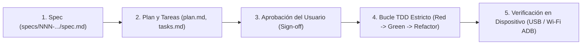

# AGENTS.md — Constitución del Proyecto `img2asciiIM`

> **Proyecto:** `img2asciiIM`
> **Application ID / Namespace:** `com.laralbir.img2asciiim`
> **Repositorio:** `https://github.com/laralbir/img2asciiIM`
> **Metodología Obligatoria:** Spec-Driven Development (**SDD**) + Test-Driven Development Estricto (**TDD**)

Este documento constituye la **ley suprema de ingeniería** para cualquier agente de IA o desarrollador humano que contribuya a `img2asciiIM`. Ningún cambio de código de negocio puede eludir las reglas aquí descritas.

---

## 1. Propósito del Producto

**img2asciiIM** es una aplicación Android nativa en Kotlin que convierte cualquier imagen (procedente de la galería, archivos locales, servicios en la nube como **Google Drive** vía SAF, cámara o el menú *Compartir* de Android) en arte compacto de texto plano (**Braille Unicode `U+2800..U+28FF`**, **ASCII monoespaciado** o **Bloques Unicode `█▓▒░`**) listo para enviarse por **WhatsApp**, **Telegram** e **Instagram Direct**.

Su caso de uso crítico son entornos con **conectividad restringida únicamente a mensajería de texto** —como los planes gratuitos de **Wi-Fi a bordo en aviones** (*Free In-Flight Messaging*), redes marítimas o cobertura móvil degradada— donde las plataformas bloquean la transferencia de imágenes y archivos multimedia pero entregan mensajes de texto plano al instante.

---

## 2. Ciclo de Vida Obligatorio (SDD → TDD)

Todo desarrollo de funcionalidad o cambio de comportamiento sigue **cinco fases secuenciales e inalterables**:



### Fase 1 — Especificación (`specs/NNN-feature/spec.md`)
- Crear o actualizar la especificación usando [`specs/TEMPLATE-spec.md`](specs/TEMPLATE-spec.md).
- Definir problema, historias de usuario, requisitos funcionales (`RF-XX`), criterios de aceptación deterministas en formato **Given / When / Then**, requisitos no funcionales (`RNF-XX`), casos borde y **Decisiones de Diseño Abiertas**.
- Toda nueva especificación nace con estado `BORRADOR`.

### Fase 2 — Planificación Arquitectónica y Tareas (`plan.md` y `tasks.md`)
- Diseñar los contratos entre capas en `plan.md` respetando Clean Architecture.
- Desglosar la entrega en *Vertical Slices* en `tasks.md`, donde **cada tarea declara explícitamente sus pasos `[RED]`, `[GREEN]` y `[REFACTOR]`**.

### Fase 3 — Aprobación del Usuario (*User Sign-off*)
- Presentar al usuario la especificación y resolver todas las **Decisiones de Diseño Abiertas**.
- Solo cuando el usuario confirma explícitamente la especificación se actualiza el estado de `spec.md` a `APROBADO` y queda desbloqueada la Fase 4.

### Fase 4 — Bucle TDD Estricto (`Red → Green → Refactor`)
1. **`[RED]` (Test que falla):** Escribir primero el test automatizado que codifica un criterio *Given/When/Then* de la especificación aprobada. Crear únicamente las firmas vacías mínimas necesarias para compilar si el tipo aún no existe (ej. `TODO("Pendiente de implementación Green")`), ejecutar la suite de pruebas y **comprobar que el test falla por el motivo esperado**.
2. **`[GREEN]` (Implementación mínima):** Escribir exclusivamente el código de producción necesario para que el nuevo test —y toda la suite previa— pase en verde. Prohibido adelantar lógica especulativa de tareas futuras.
3. **`[REFACTOR]` (Limpieza bajo red de seguridad):** Eliminar duplicación, optimizar asignaciones de memoria, mejorar nombres y verificar que todas las pruebas y el linter siguen en verde antes de avanzar al siguiente ciclo.

### Fase 5 — Verificación en Dispositivo Real / AVD (USB o Wi-Fi)
- Compilar, instalar y ejecutar pruebas instrumentadas (`./gradlew connectedDebugAndroidTest`) sobre un dispositivo Android físico conectado por **USB o ADB Wi-Fi** (o AVD cuando no haya hardware físico conectado).
- Validar comportamiento **100% offline** (Modo Avión / red cortada), consumo de memoria con fotografías reales de alta resolución y legibilidad real de la burbuja de chat.
- Marcar el estado de la especificación como `IMPLEMENTADO` únicamente al superar las 5 fases.

---

## 3. Reglas Inquebrantables (*Hard Rules*)

1. **Cero código de producción sin Spec aprobada y Test en Rojo (`Red`):** Está terminantemente prohibido implementar lógica de negocio, renderizadores, decodificadores o pantallas de funcionalidad sin un requisito trazable en `specs/` con estado `APROBADO` y un test automatizado fallando previamente. *(Excepción única: el esqueleto vacío inicial de Gradle/`Application`/`MainActivity` de arranque necesario para habilitar el arnés de pruebas).*
2. **Procesamiento 100% Offline en Dispositivo:** El motor de conversión jamás realiza peticiones HTTP ni depende de servidores externos. La app de producción **no declara `android.permission.INTERNET`**.
3. **Cero Permisos Invasivos de Almacenamiento:** Prohibido solicitar `READ_EXTERNAL_STORAGE`, `WRITE_EXTERNAL_STORAGE`, `READ_MEDIA_IMAGES` o `MANAGE_EXTERNAL_STORAGE`. Toda entrada de imágenes se realiza mediante contratos delegados al sistema:
   - `ActivityResultContracts.PickVisualMedia` (Android Photo Picker local + nube integrada).
   - `ActivityResultContracts.OpenDocument` con `image/*` (Storage Access Framework: memoria interna, SD, USB OTG, **Google Drive**, OneDrive, Dropbox, Nextcloud).
   - `ActivityResultContracts.TakePicture` con `FileProvider` sobre caché privada (o `CameraX` únicamente si el usuario lo aprueba expresamente en una especificación).
   - Recepción de `Intent.ACTION_SEND` (`image/*`) desde el Share Sheet del sistema.
4. **Decodificación Segura frente a `OutOfMemoryError`:** Prohibido invocar `BitmapFactory.decodeStream` o `ImageDecoder.decodeBitmap` a resolución completa sin calcular antes el factor de reducción (`inSampleSize` / `setTargetSize`) proporcional a la rejilla máxima de caracteres. El pico de RAM del pipeline debe mantenerse **< 20 MB** incluso ante capturas de 48 MP–200 MP.
5. **Pureza del Dominio:** El paquete `com.laralbir.img2asciiim.domain` no puede importar **ninguna** clase de `android.*` ni `androidx.*`. Debe compilar y ejecutarse íntegramente sobre la JVM estándar.

---

## 4. Arquitectura Limpia en Kotlin (*Clean Architecture*)

El código fuente bajo `app/src/main/java/com/laralbir/img2asciiim/` se estructura en tres capas con flujo estricto de dependencias hacia el interior (`ui` → `domain` ← `data`):

### 4.1 `domain/` — Núcleo de Negocio (100% Kotlin Puro)
- **Restricción:** Cero imports `android.*` o `androidx.*`. Cero efectos secundarios de E/S.
- **Responsabilidades:**
  - `PixelGrid` inmutable y extractores de luminancia perceptual (`BT.709`) con composición determinista de canal alfa.
  - Ajustes tonales (brillo, contraste, inversión claro/oscuro para fondos de chat claros u oscuros).
  - Remuestreador por promedio de área con corrección de relación de aspecto tipográfica (`charAspectRatio`) y geometría de subpíxeles.
  - Algoritmos de difusión de error (*Floyd-Steinberg* y *Atkinson*).
  - Renderizadores de texto:
    - **Braille Unicode (`U+2800`..`U+28FF`)**: celdas de 2×4 puntos; uso obligatorio de `U+2800` (*Braille Pattern Blank*) para celdas vacías con el fin de impedir el colapso de espacios en fuentes proporcionales (crítico en Instagram Direct).
    - **ASCII Monoespaciado Clásico** y **Bloques Sombreados Unicode (`█▓▒░`)**.
  - Formateadores de plataforma IM (envoltorio ```` ```\n...\n``` ```` para WhatsApp/Telegram; texto directo sin backticks para Instagram Direct) y calculadores/ajustadores estrictos de presupuesto de caracteres (`65.536` WhatsApp, `4.096` Telegram, `1.000` Instagram Direct).
  - Interfaces puras de puertos de entrada de datos (ej. `ImageSourceDecoder`).
- **SLA de Tests:** La suite completa de `domain/` se ejecuta en JVM local en **< 100 ms**.

### 4.2 `data/` — Adaptadores del Sistema Android
- **Responsabilidades:**
  - Decodificación segura de `Uri` mediante `ContentResolver` + `ImageDecoder` (API 28+) / `BitmapFactory` con submuestreo previo a la asignación de memoria.
  - Lectura y normalización de orientación **EXIF** (`androidx.exifinterface`) para rotaciones `90°/180°/270°` y espejados.
  - Gestión limpia de archivos temporales de cámara mediante `FileProvider` en `cacheDir/camera_captures/`.
  - Adaptadores resilientes para URIs remotas/SAF (ej. archivos de **Google Drive** en caché vs. no disponibles sin red, traduciendo `IOException` a errores de dominio tipados).
  - Construcción y resolución segura de `Intent` de envío (`com.whatsapp`, `org.telegram.messenger`, `com.instagram.android`) con declaración `<queries>` en Android 11+ y fallback garantizado al Share Sheet del sistema (`Intent.createChooser`), además del servicio de portapapeles (`ClipboardManager`).

### 4.3 `ui/` — Presentación Reactiva Unidireccional (UDF)
- **Stack:** Jetpack Compose con **Material 3**, diseño **Edge-to-Edge**, **Navigation 3**, `ViewModel` + un único `StateFlow<UiState>` inmutable + canal de efectos efímeros.
- **Responsabilidades:**
  - Lanzadores de contratos de actividad (`rememberLauncherForActivityResult` para `PickVisualMedia`, `OpenDocument` y `TakePicture`).
  - Vista previa fiel de **burbuja de chat** con conmutador de tema claro/oscuro, contador de caracteres en tiempo real y avisos de presupuesto/ancho.
  - Controles deslizantes fluidos (60/120 fps) ejecutando el recálculo pesado en `Dispatchers.Default` mediante cancelación cooperativa (`collectLatest`).
  - Accesibilidad completa (`contentDescription` semánticos para TalkBack sin deletreo masivo de caracteres Braille y objetivos táctiles `≥ 48dp`).
- **Estrategia de Tests UI:**
  - `ViewModel`: `kotlinx-coroutines-test` (`StandardTestDispatcher`) + **Turbine**.
  - Pantallas y componentes Compose en JVM: **Robolectric** + `createComposeRule()`.
  - Flujos de dispositivo real: `connectedDebugAndroidTest` (Compose Android Test + Espresso Intents/Clipboard).

---

## 5. Roles del Equipo Multi-Agente

Cuando múltiples agentes colaboran en paralelo o en secuencia sobre `img2asciiIM`, deben respetar sus fronteras de responsabilidad y archivos para evitar conflictos de escritura:

| Rol (`Agent Role`) | Responsabilidad Principal | Archivos Autorizados |
| :--- | :--- | :--- |
| **`sdd-architect`** | Autoría y gobernanza de `AGENTS.md` y del árbol `specs/` (`TEMPLATE-spec.md`, `spec.md`, `plan.md`, `tasks.md`). Audita trazabilidad requisito ↔ test y bloquea desvíos del ciclo SDD. | `AGENTS.md`, `specs/**` |
| **`kotlin-tdd-scaffolder`** | Inicialización del esqueleto Android/Kotlin y ejecución rigurosa de los *Vertical Slices* en bucle `[RED] -> [GREEN] -> [REFACTOR]` sobre `domain/`, `data/` y `ui/`. | `app/**`, `gradle/**`, `build.gradle.kts`, `settings.gradle.kts`, `gradle.properties` |
| **`adb-devops-engineer`** | Automatización de build/test (`Makefile`, `scripts/`), detección y enlace de dispositivos por **USB y ADB Wi-Fi** (emparejamiento inalámbrico y TCP/IP), despliegue de APK y recolección de reportes. | `Makefile`, `scripts/**`, `README.md` |
| **`research`** | Investigación verificable sobre límites reales de clientes IM (WhatsApp, Telegram, Instagram DM), estándar Unicode Braille, APIs de Android SDK y compatibilidad de librerías. | Solo lectura / informes hacia otros agentes (sin mutar código de producción). |
| **`qa-device-verifier`** | Auditoría independiente de aceptación *Given/When/Then* en hardware físico o AVD, medición de tiempos (`< 150 ms`), memoria (`< 20 MB`), accesibilidad y pruebas en Modo Avión. | Reportes de verificación y ejecución de tareas Gradle/ADB. |

---

## 6. Comandos de Verificación Continua

Antes de dar por completada cualquier tarea de `tasks.md`, el agente responsable debe ejecutar y verificar en limpio:

```bash
# 1. Suite unitaria JVM + Robolectric (rápida, obligatoria en cada paso RED y GREEN)
./gradlew testDebugUnitTest

# 2. Análisis estático y reglas de Android Lint (incluye visibilidad <queries> y accesibilidad)
./gradlew lintDebug

# 3. Ensamblado del APK de depuración
./gradlew assembleDebug

# 4. Pruebas instrumentadas E2E en dispositivo conectado por USB o Wi-Fi ADB
./gradlew connectedDebugAndroidTest
```

---

## 7. Convenciones de Código y Commits

- **Idioma:** Documentación, especificaciones (`specs/`), comentarios de dominio relevantes y textos de interfaz de usuario por defecto en **español claro y profesional** (soportando internacionalización mediante `strings.xml`). Identificadores de código Kotlin (clases, funciones, propiedades) en **inglés técnico idiomático**.
- **Gestión de errores:** Prohibido silenciar excepciones (`catch (_: Exception) {}`). Usar tipos explícitos (`Result<T>` o jerarquías `sealed interface` de error de dominio).
- **Trazabilidad en Commits y Tareas:** Referenciar siempre el identificador de especificación y slice, por ejemplo: `feat(001-slice2): renderizador Braille Unicode U+2800 y dithering Floyd-Steinberg`.
