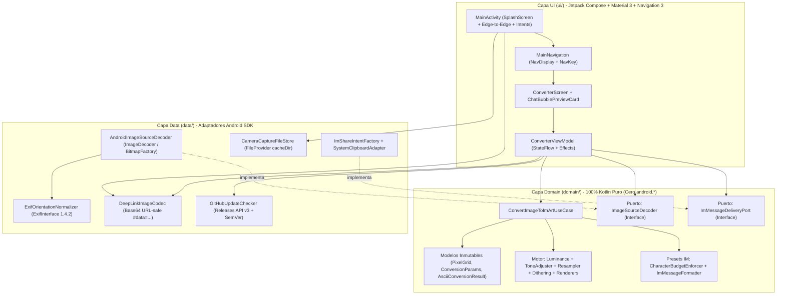
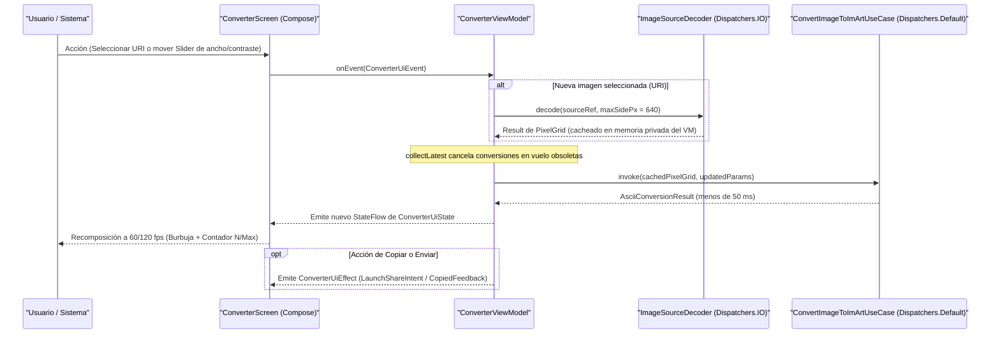
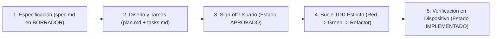
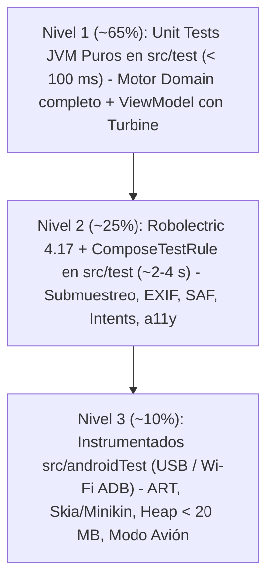
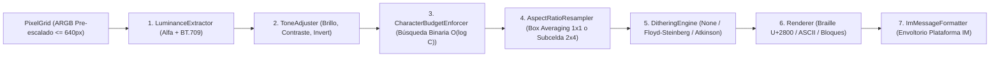
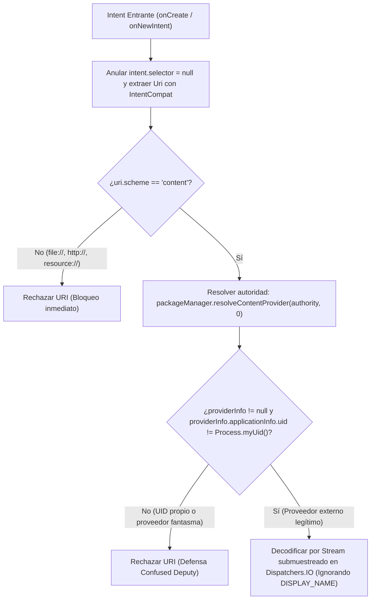
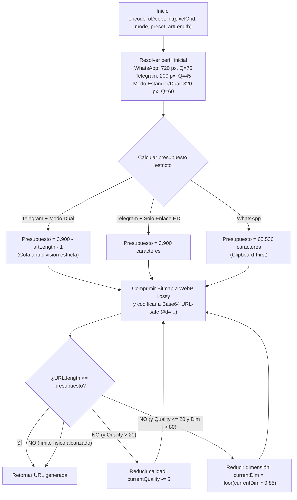
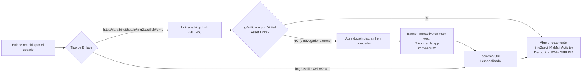
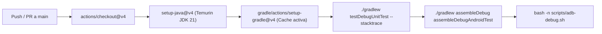
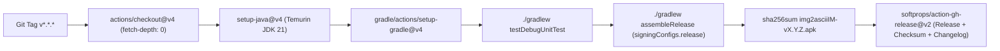

# Documentación Técnica del Desarrollo — `img2asciiIM`

> **Proyecto:** `img2asciiIM` (`com.laralbir.img2asciiim`)  
> **Plataforma:** Android Nativo (`minSdk = 26` · `targetSdk = 37` · `compileSdk = 37.0`)  
> **Metodología de Ingeniería:** Spec-Driven Development (**SDD**) + Test-Driven Development Estricto (**TDD**)  
> **Naturaleza Operativa:** Procesamiento **100 % Offline en Dispositivo** · **Cero Permisos Invasivos**

Este documento constituye la referencia de ingeniería de software de **`img2asciiIM`**. Describe en profundidad el stack tecnológico moderno basado en AGP 9 y Kotlin 2.3, la arquitectura limpia reactiva, el flujo metodológico SDD/TDD, los fundamentos matemáticos y tipográficos del motor de conversión a texto para mensajería instantánea, el modelo de seguridad de cero permisos, la identidad visual nativa y la automatización de pruebas, CI/CD y despliegue por USB y Wi-Fi ADB.

---

## Índice de Contenidos

1. [Visión Arquitectónica y Stack Tecnológico Moderno](#1-visión-arquitectónica-y-stack-tecnológico-moderno)
2. [Metodología SDD + TDD Estricto](#2-metodología-sdd--tdd-estricto)
3. [Ingeniería del Motor de Conversión 100 % Offline (`domain/`)](#3-ingeniería-del-motor-de-conversión-100--offline-domain)
4. [Capa de Datos, Seguridad, Enlaces HD y Actualizaciones (`data/`)](#4-capa-de-datos-seguridad-enlaces-hd-y-actualizaciones-data)
5. [Identidad Visual Nativa y Arranque (`RF-05`)](#5-identidad-visual-nativa-y-arranque-rf-05)
6. [Guía de Compilación, Tests, CI/CD y Despliegue Multi-Dispositivo (USB y Wi-Fi)](#6-guía-de-compilación-tests-cicd-y-despliegue-multi-dispositivo-usb-y-wi-fi)

---

## 1. Visión Arquitectónica y Stack Tecnológico Moderno

### 1.1 Propósito Técnico del Sistema

**`img2asciiIM`** resuelve una limitación física y de protocolo habitual en redes restringidas —como los planes gratuitos de **Wi-Fi a bordo en aerolíneas comerciales** (*Free In-Flight Messaging*), enlaces marítimos o redes móviles congestionadas— donde los firewalls de inspección profunda de paquetes (DPI) y el filtrado por SNI/DNS bloquean las CDNs multimedia (`mmg.whatsapp.net`, `rupload.facebook.com`, servidores de medios MTProto), pero permiten los sockets ligeros de mensajería de texto plano.

La aplicación transforma localmente en el teléfono cualquier fotografía o documento gráfico en arte compacto de texto plano (**Braille Unicode `U+2800`–`U+28FF`**, **ASCII monoespaciado** o **Bloques sombreados Unicode `█▓▒░`**) calibrado matemáticamente a las reglas tipográficas y presupuestos de caracteres de **WhatsApp**, **Telegram** e **Instagram Direct**.

### 1.2 Stack Tecnológico Oficial

El proyecto se apoya en la generación actual de herramientas de compilación y librerías Jetpack gestionadas de forma centralizada mediante catálogo de versiones (`gradle/libs.versions.toml`):

| Categoría | Componente / Artefacto | Versión | Rol Arquitectónico y Justificación |
| :--- | :--- | :---: | :--- |
| **Lenguaje y Compiladores** | **Kotlin** (`kotlin`, `compose-compiler`, `kotlin-serialization`) | `2.3.20` | Lenguaje único del proyecto (código + scripts KTS), compilador K2 de alto rendimiento, *value classes* y serialización tipada sin reflexión para rutas de navegación. |
| **Sistema de Build** | **Android Gradle Plugin (AGP)** | `9.0.1` | Soporte **Built-in Kotlin** nativo en `com.android.application`, *Non-Transitive R Classes*, `buildConfig = true` para versionado semántico in-app y optimización de recursos. |
| **Motor de Construcción** | **Gradle Wrapper** | `9.1.0` | **Configuration Cache** (`org.gradle.configuration-cache=true`) y **Build Cache** (`org.gradle.caching=true`) activados por defecto para ejecuciones TDD sub-segundo. `jvmToolchain(17)` en compilación de bytecode. |
| **Nivel de API Android** | **`minSdk` / `targetSdk` / `compileSdk`** | `26` / `37` / `37.0` | Cobertura desde Android 8.0 Oreo (iconos adaptativos nativos, `java.time`) hasta Android 17 (`release(37)` con `buildToolsVersion = "37.0.0"`), cumpliendo las políticas más recientes de seguridad e *intents*. |
| **Interfaz Declarativa** | **Jetpack Compose BOM** + **Material 3** | `2026.03.01` | UI 100 % declarativa, sistema de diseño Material You (esquemas dinámicos y modos claro/oscuro) y previsualización fiel de burbujas de mensajería. |
| **Ventana e Inmersión** | **Activity Compose & Edge-to-Edge** (`androidx.activity:activity-compose`) | `1.13.0` | Renderizado a pantalla completa (`enableEdgeToEdge()`), manejo reactivo de *insets* de barras de sistema, teclado `adjustResize` y contratos desacoplados `ActivityResultContracts`. |
| **Navegación Tipada** | **Jetpack Navigation 3** (`navigation3-runtime`, `navigation3-ui`, `lifecycle-viewmodel-navigation3`) | `1.0.1` / `2.10.0` | Pila de navegación explícita y reactiva (`rememberNavBackStack`) gobernada por claves `@Serializable` que implementan `NavKey`, con ámbito de `ViewModel` ligado a cada entrada en `NavDisplay`. |
| **Arranque Nativo** | **Core SplashScreen** (`androidx.core:core-splashscreen`) | `1.2.0` | Retroportabilidad uniforme de la ventana de inicio del sistema entre API 26 y API 37 sin actividades intermedias ni retardos artificiales. |
| **Metadatos Ópticos** | **AndroidX ExifInterface** (`androidx.exifinterface:exifinterface`) | `1.4.2` | Extracción fiable de etiquetas de rotación y espejado EXIF sobre descriptores/streams de `ContentResolver` para JPEG, WebP y HEIC. |
| **Concurrencia y Estado** | **Kotlin Coroutines & Lifecycle Compose** | `1.10.2` / `2.10.0` | Ejecución fuera del hilo principal (`Dispatchers.Default` para CPU, `Dispatchers.IO` para streams), cancelación cooperativa (`collectLatest`) y recolección consciente del ciclo de vida (`collectAsStateWithLifecycle`). |
| **Arnés de Testing** | **JUnit 4**, **Turbine**, **Robolectric**, **Compose UI Test**, **Espresso** | `4.13.2` / `1.2.1` / `4.17` / `3.7.0` | Verificación determinista en tres niveles: unitarios puros JVM (`< 100 ms`), integración Android/Compose en JVM vía Robolectric `4.17` y pruebas instrumentadas reales. |

> [!NOTE]
> En **AGP `9.0.1`**, el soporte de Kotlin está integrado directamente en el plugin `com.android.application`. Esto simplifica `app/build.gradle.kts` (aplicando únicamente `android.application`, `compose.compiler` y `kotlin.serialization`) y garantiza compatibilidad total con la **Configuration Cache** de Gradle `9.1.0`.

### 1.3 Clean Architecture: Regla de Dependencia Estricta

El código bajo `app/src/main/kotlin/com/laralbir/img2asciiim/` se divide en **tres capas concéntricas** conectadas mediante inversión de dependencias (`ui` → `domain` ← `data`) y ensambladas por un contenedor ligero sin reflexión (`di/AppContainer.kt`):



#### Invariantes de Separación por Capa

1. **`domain/` (Núcleo Puro de Negocio):**
   - **Prohibición absoluta de dependencias del framework:** Ningún archivo de `domain/` puede importar paquetes `android.*` ni `androidx.*`.
   - Opera únicamente con tipos primitivos, `FloatArray`/`IntArray` encapsulados en estructuras inmutables (`PixelGrid`), `Result<T>` y jerarquías `sealed interface` de errores de dominio (`DomainError`).
   - Se compila y prueba directamente sobre la JVM estándar en menos de **100 ms**.
2. **`data/` (Adaptadores del Sistema Operativo):**
   - Implementa los puertos declarados en `domain/port/` traduciendo primitivas de Android (`Uri`, `ContentResolver`, `Bitmap`, `ExifInterface`, `PackageManager`, `ClipboardManager`, `Intent`) a tipos puros de dominio.
   - Contiene las barreras de memoria (`SampleSizeCalculator`), seguridad de URIs y resiliencia ante fallos de entrada/salida en proveedores cloud SAF.
3. **`ui/` (Presentación Reactiva Unidireccional):**
   - Renderiza un único estado inmutable `ConverterUiState` mediante Jetpack Compose y Material 3.
   - Navega mediante **Navigation 3** (`NavDisplay` respaldado por `rememberNavBackStack` y decoradores `rememberSaveableStateHolderNavEntryDecorator()` + `rememberViewModelStoreNavEntryDecorator()`), protegiendo transiciones frente a pulsaciones repetidas con `dropUnlessResumed`.
   - Nunca bloquea su orientación (`screenOrientation` libre en `AndroidManifest.xml`), adaptándose a móviles verticales, apaisados, pantallas divididas y dispositivos plegables.

### 1.4 Flujo de Datos Unidireccional (UDF) y Concurrencia Cooperativa

Toda interacción en la interfaz sigue un ciclo determinista **Unidirectional Data Flow (UDF)**:



> [!TIP]
> El `PixelGrid` decodificado (~`640 px` de lado máximo) se conserva en una referencia interna del `ConverterViewModel` separada de `ConverterUiState`. Así, al deslizar continuamente los controles de ancho, brillo, contraste o *dithering*, **jamás se re-decodifica el stream de la `Uri`** ni se comparan matrices grandes durante la recomposición de Compose; además, `collectLatest` descarta de inmediato cualquier fotograma intermedio superado por un nuevo valor del *slider*.

---

## 2. Metodología SDD + TDD Estricto

El desarrollo de `img2asciiIM` se rige por la constitución técnica definida en [`AGENTS.md`](../AGENTS.md): **ninguna línea de lógica de producción puede escribirse sin una especificación aprobada y un test automatizado fallando previamente**.

### 2.1 Ciclo de Vida en 5 Fases (`specs/NNN/spec.md` → `IMPLEMENTADO`)



1. **Fase 1 — Especificación (`specs/NNN-feature/spec.md`):** Definición formal del problema, historias de usuario, requisitos funcionales (`RF-01`..`RF-05`), criterios de aceptación deterministas **Given / When / Then**, invariantes matemáticos, requisitos no funcionales medibles (`RNF-01`..`RNF-06`), casos borde (`CB-01`..`CB-07`) y Decisiones de Diseño Abiertas (`DD-XX`). Nace bloqueada en estado `BORRADOR`.
2. **Fase 2 — Planificación y Particionado (`plan.md` y `tasks.md`):** Diseño de contratos entre capas Clean Architecture y descomposición en *Vertical Slices* secuenciales donde cada tarea explicita sus tres pasos obligatorios `[RED]`, `[GREEN]` y `[REFACTOR]`.
3. **Fase 3 — *Sign-off* del Usuario (`APROBADO`):** Resolución explícita de las Decisiones de Diseño Abiertas y aprobación del usuario. Solo en este punto se desbloquea la escritura de código funcional.
4. **Fase 4 — Bucle TDD Estricto (`Red → Green → Refactor`):**
   - **`[RED]` (Test que falla por el motivo correcto):** Codificar el criterio *Given/When/Then* en un test automatizado. Si el símbolo bajo prueba aún no existe, crear únicamente la firma mínima vacía (`TODO("Pendiente de implementación Green")`), ejecutar `./gradlew testDebugUnitTest` y comprobar el fallo esperado.
   - **`[GREEN]` (Implementación mínima suficiente):** Escribir exclusivamente el código de producción requerido para que el test nuevo y toda la suite existente pasen en verde, sin introducir generalizaciones prematuras ni código especulativo.
   - **`[REFACTOR]` (Optimización bajo red de seguridad):** Eliminar duplicación, reemplazar colecciones con *boxing* por arrays primitivos contiguos (`FloatArray`, `StringBuilder` preasignado), pulir semántica y verificar que tests + `./gradlew lintDebug` permanecen en verde.
5. **Fase 5 — Verificación Física End-to-End (`IMPLEMENTADO`):** Ejecución de `./gradlew connectedDebugAndroidTest` sobre hardware Android conectado por **USB o Wi-Fi ADB** (o AVD), validando Modo Avión, presupuesto de memoria `< 20 MB` y legibilidad real en pantalla antes de sellar la especificación como `IMPLEMENTADO`.

### 2.2 Pirámide de Tests en 3 Niveles

La estrategia de verificación maximiza la velocidad de retroalimentación en local sin renunciar a la fidelidad en silicio real:



| Nivel | Ubicación y Runner | Herramientas Clave | Alcance Verificado | Tiempo Objetivo |
| :--- | :--- | :--- | :--- | :---: |
| **Nivel 1: JVM Pura** | `app/src/test/` (JUnit 4 estándar) | `kotlin.test`, `kotlinx-coroutines-test` (`runTest`, `StandardTestDispatcher`), `Turbine 1.2.1` | Luminancia `BT.709`, composición alfa, ajuste tonal, *box resampling*, *dithering* Floyd-Steinberg/Atkinson, bits Braille `U+2800..U+28FF`, búsqueda binaria de presupuesto IM y transiciones de `StateFlow`/`UiEffect` en `ViewModel`. | **`< 100 ms`** (`domain/`) |
| **Nivel 2: Robolectric + Compose JVM** | `app/src/test/` (`RobolectricTestRunner` `4.17`) | `createComposeRule()`, `StateRestorationTester`, `ShadowPackageManager`, `ExifInterface` | Cálculo de `inSampleSize`, normalización de las 8 orientaciones EXIF, manejo de `IOException` en streams SAF/Drive, auditoría de `AndroidManifest.xml` (cero permisos + `<queries>`), resolución de `Intent`s y semántica TalkBack (`onNodeWithContentDescription`). | **`~2–4 s`** (sin emulador) |
| **Nivel 3: Instrumentados E2E** | `app/src/androidTest/` (`AndroidJUnitRunner`) | Compose Android Test, `ClipboardManager` real, `Runtime.getRuntime()`, Espresso `3.7.0` | Conversión real de imagen de `48 MP` (`8000 × 6000`) en `< 150 ms` con `< 20 MB` de heap en runtime ART, no-colapso métrico de `U+2800` sobre Skia/Minikin, copia real al portapapeles y operación 100 % offline. | Ejecución en dispositivo USB / Wi-Fi |

### 2.3 Regla Arquitectónica: *Fakes sobre Mocks*

En `img2asciiIM` se priorizan **implementaciones `Fake*` deterministas con estado** frente a librerías de *mocking* basadas en reflexión o generación de bytecode:

- **Por qué se evitan los mocks frágiles:** Los mocks acoplan los tests a detalles internos de interacción (orden exacto de llamadas privadas), penalizan el arranque de la JVM en miles de milisegundos y pueden enmascarar inconsistencias de estado en flujos concurrentes (`Flow` / `StateFlow`).
- **Diseño con Fakes en constructores:** Cada dependencia externa se modela como una interfaz estrecha en `domain/` (por ejemplo, `ImageSourceDecoder`, `ImMessageDeliveryPort` o `WorkspaceReadinessRepository`). En `src/test`, se inyectan directamente clases `Fake*` en memoria que permiten simular latencias, ráfagas de emisiones o fallos de E/S deterministas (`CloudFileOfflineUnavailable`):

```kotlin
private class FakeImageSourceDecoder(
    var nextResult: Result<PixelGrid> = Result.failure(DomainError.EmptyImage),
) : ImageSourceDecoder {
    var decodeCallCount: Int = 0
        private set

    override suspend fun decode(source: ImageSourceRef, maxSidePx: Int): Result<PixelGrid> {
        decodeCallCount++
        return nextResult
    }
}
```

---

## 3. Ingeniería del Motor de Conversión 100 % Offline (`domain/`)

### 3.1 Justificación Física y Pipeline Completo en Memoria

En los planes *Free Messaging* de aerolíneas (Iberia, Vueling, Lufthansa, Delta, United, Air Europa), el router satelital bloquea cualquier consulta DNS/TLS hacia APIs externas (`NXDOMAIN` o redirección al portal cautivo). Además, muchos pasajeros editan sus capturas en **Modo Avión estricto** antes de conectar el Wi-Fi un instante para enviar el mensaje. Por ello, **todo el pipeline matemático reside en `domain/` sin llamadas de red**:



### 3.2 Luminancia Perceptual `BT.709` y Composición Alfa Determinista (`CB-01`)

Antes de calcular el brillo de cada píxel $p = (A, R, G, B)$ con canales en $[0, 255]$, el motor resuelve la transparencia para evitar un defecto clásico de los conversores ingenuos: los stickers PNG o WebP recortados suelen almacenar sus píxeles transparentes como `RGBA(0, 0, 0, 0)`, lo que sin composición alfa los convertiría erróneamente en bloques negros sólidos alrededor del sujeto.

1. **Composición Alfa consciente de `invert`:** Sea $\alpha = A / 255.0 \in [0.0, 1.0]$ y $C \in \{R, G, B\}$ normalizado en $[0.0, 1.0]$. El color de fondo sintético $C_{\text{bg}}$ se elige deterministamente según la polaridad del arte:
   - Si `invert == false` (pensado para **burbuja clara** con tinta oscura, donde el fondo sin tinta es luminoso): se compone sobre **blanco puro** ($C_{\text{bg}} = 1.0$).
   - Si `invert == true` (pensado para **burbuja oscura** con tinta clara, donde el fondo sin tinta es oscuro): se compone sobre **negro puro** ($C_{\text{bg}} = 0.0$).
   $$C_{\text{comp}} = C_{\text{norm}} \cdot \alpha + C_{\text{bg}} \cdot (1.0 - \alpha)$$

2. **Ponderación Fotométrica ITU-R `BT.709`:** El ojo humano es mucho más sensible al espectro verde que al rojo y especialmente que al azul. La luminancia relativa se obtiene mediante:
   $$Y = \operatorname{clamp}\!\left(0.2126 \cdot R_{\text{comp}} + 0.7152 \cdot G_{\text{comp}} + 0.0722 \cdot B_{\text{comp}},\; 0.0,\; 1.0\right)$$

### 3.3 Ajuste Tonal y Remuestreo con Compensación de Aspecto Tipográfico

#### Ecuación de Ajuste Tonal (`ToneAdjuster`)

Dado un valor de luminancia $Y \in [0.0, 1.0]$, un desplazamiento de brillo $b \in [-1.0, +1.0]$ (`brightness`) y un factor multiplicativo de contraste $c \in [0.5, 3.0]$ (`contrast`) anclado en el gris medio `0.5`:

$$Y_{\text{tonal}} = \operatorname{clamp}\!\left((Y + b - 0.5) \cdot c + 0.5,\; 0.0,\; 1.0\right)$$

A continuación se traduce la luminancia ajustada en **densidad óptica de tinta** $D \in [0.0, 1.0]$ (donde `1.0` representa máxima tinta/puntos encendidos y `0.0` celda vacía):
- Con `invert == false` (tinta oscura sobre fondo claro): $D = 1.0 - Y_{\text{tonal}}$ (las sombras de la foto reciben más tinta).
- Con `invert == true` (tinta clara sobre fondo oscuro): $D = Y_{\text{tonal}}$ (las luces de la foto reciben más tinta, logrando inversión simétrica exacta).

#### Remuestreo por Promedio de Área y Submatriz `2×4` (`AspectRatioResampler`)

Los caracteres en una fuente de chat móvil (`Roboto Mono` o `NotoSansSymbols`) **no son cuadrados**: cada celda de carácter presenta una relación ancho:alto aproximada de **`cellWidthToHeightRatio ≈ 0.50`** (`1:2`). Si se muestreara 1 carácter por cada bloque cuadrado de píxeles, cualquier retrato o código QR aparecería estirado verticalmente al doble de su altura real.

Para una imagen de dimensiones orientadas $(W_{\text{img}}, H_{\text{img}})$ y un ancho objetivo de $C$ columnas de caracteres:

1. **Filas de caracteres ($R$):**
   $$R = \max\!\left(1,\; \operatorname{round}\!\left(C \cdot \frac{H_{\text{img}}}{W_{\text{img}}} \cdot 0.50\right)\right)$$
   Por ejemplo, una fotografía cuadrada de `1000 × 1000 px` renderizada a `C = 32` columnas produce exactamente **`R = 16` filas** (`32 × 16` caracteres), recuperando una proporción visual `1:1` perfecta en la burbuja del móvil. El operador `coerceAtLeast(1)` protege contra divisiones por cero o colapso a `0` filas en panorámicas extremas como `10000 × 200 px` (`CB-03`).

2. **Rejilla de muestreo efectivo $(W_{\text{grid}}, H_{\text{grid}})$:**
   - En modos **`ASCII_CLASSIC`** y **`UNICODE_BLOCKS`** (`1×1` muestra por carácter): $W_{\text{grid}} = C$, $H_{\text{grid}} = R$.
   - En modo **`BRAILLE_UNICODE`** (cada carácter aloja una submatriz binaria de **`2 × 4` puntos**):
     $$W_{\text{grid}} = 2 \cdot C, \qquad H_{\text{grid}} = 4 \cdot R$$
     Dado que una celda de aspecto `1:2` se subdivide en `2` columnas × `4` filas, **cada micropunto Braille individual posee una relación de aspecto prácticamente cuadrada (`1:1`)**, multiplicando por **8×** la resolución espacial efectiva por carácter.

3. **Integración por Promedio de Caja (*Box / Area Averaging*):** En lugar de *nearest-neighbor* (que introduce *aliasing* severo y pierde líneas finas), cada celda $(gx, gy)$ promedia todos los píxeles fuente cubiertos por su ventana rectangular proyectada sobre `PixelGrid`, operando sobre un `FloatArray` plano contiguo.

### 3.4 Algorítmica de *Dithering* por Difusión de Error (`DitheringEngine`)

Al cuantizar tonos continuos $D \in [0.0, 1.0]$ a un conjunto discreto reducido de niveles —especialmente crítico en **Braille Unicode**, donde cada uno de los 8 subpuntos es estrictamente binario (`encendido` si $\hat{D} \ge 0.5$, `apagado` si $\hat{D} < 0.5$)—, un umbral fijo (`DitherMode.NONE`) destruye los degradados suaves convirtiendo zonas grises enteras en bloques planos blancos o negros (`CA-02.4`).

`DitheringEngine` recorre la rejilla de izquierda a derecha y de arriba abajo sobre buffers `FloatArray` reutilizables, cuantiza el valor actual $q = \operatorname{quantize}(v)$, calcula el residuo de cuantización $e = v - q$ e inyecta fracciones exactas del error en los píxeles vecinos aún no procesados:

#### 1. Floyd-Steinberg (`DitherMode.FLOYD_STEINBERG`)
Conserva el **100 % del error (`16/16`)** repartiéndolo entre **4 vecinos** en una ventana de 2 filas:

```text
          [  *  ]   7/16
  3/16     5/16     1/16
```

- $(x + 1, y) \mathrel{+}= e \times \frac{7}{16}$
- $(x - 1, y + 1) \mathrel{+}= e \times \frac{3}{16}$
- $(x,\; y + 1) \mathrel{+}= e \times \frac{5}{16}$
- $(x + 1, y + 1) \mathrel{+}= e \times \frac{1}{16}$

**Perfil visual:** Produce transiciones orgánicas y fieles al rango tonal continuo en paisajes, cielos y fotografías generales.

#### 2. Atkinson (`DitherMode.ATKINSON`)
Diseñado originalmente por Bill Atkinson, propaga únicamente **`6/8` (`75 %`) del error** en fracciones iguales de **`1/8`** sobre **6 vecinos** en una ventana de 3 filas, absorbiendo deliberadamente el `25 %` restante:

```text
          [  *  ]   1/8     1/8
  1/8      1/8      1/8
           1/8
```

- $(x + 1, y),\; (x + 2, y),\; (x - 1, y + 1),\; (x, y + 1),\; (x + 1, y + 1),\; (x, y + 2) \mathrel{+}= e \times \frac{1}{8}$

**Perfil visual:** Al disipar un cuarto del error acumulado, evita el "grano fantasma" en zonas casi blancas o casi negras y acentúa el **micro-contraste local en bordes**, resultando sobresaliente para rostros, siluetas, logotipos, mapas y tarjetas de embarque en resoluciones compactas de chat.

### 3.5 Codificación Braille Unicode (`U+2800`–`U+28FF`, ISO/TR 11548-1)

El bloque Unicode *Braille Patterns* (`U+2800`..`U+28FF`, 256 glifos en el *Basic Multilingual Plane*) codifica todas las combinaciones posibles de una celda de **2 columnas (`dx ∈ {0, 1}`) × 4 filas (`dy ∈ {0, 1, 2, 3}`)**.

> [!WARNING]
> **Trampa histórica del estándar ISO/TR 11548-1:** Los bits **no** siguen un orden secuencial continuo `0..3` en la primera columna y `4..7` en la segunda. Debido a que el Braille clásico constaba de 6 puntos (`1..6`) y los puntos inferiores `7` y `8` se estandarizaron posteriormente, la fila inferior (`dy = 3`) ocupa los **bits 6 (`0x40`) y 7 (`0x80`)**, mientras que el extremo superior derecho (`dx = 1, dy = 0`) es el **Punto 4 (`0x08`)**. Intercambiar `0x08` con `0x40` deforma todas las líneas horizontales de la imagen.

#### Mapa Exacto de Bits por Subpíxel

| Fila en la Celda (`dy`) | Columna Izquierda (`dx = 0`) | Bit / Máscara Hex | Columna Derecha (`dx = 1`) | Bit / Máscara Hex |
| :---: | :---: | :---: | :---: | :---: |
| **`dy = 0`** *(Superior)* | Punto 1 | `1 shl 0` = **`0x01`** | Punto 4 | `1 shl 3` = **`0x08`** |
| **`dy = 1`** *(Media-alta)* | Punto 2 | `1 shl 1` = **`0x02`** | Punto 5 | `1 shl 4` = **`0x10`** |
| **`dy = 2`** *(Media-baja)* | Punto 3 | `1 shl 2` = **`0x04`** | Punto 6 | `1 shl 5` = **`0x20`** |
| **`dy = 3`** *(Inferior)* | **Punto 7** | `1 shl 6` = **`0x40`** | **Punto 8** | `1 shl 7` = **`0x80`** |

El carácter emitido para cada bloque `2×4` se obtiene en tiempo constante sin asignaciones intermedias:

$$\text{codePoint} = \mathtt{0x2800} + \sum_{dx=0}^{1} \sum_{dy=0}^{3} \operatorname{active}(dx, dy) \cdot \operatorname{mask}(dx, dy)$$

- **Celda vacía (0 puntos activos):** `0x2800 + 0x00` = **`U+2800` (`'⠀'`, *Braille Pattern Blank*)**.
- **Celda diagonal `(0,0)` + `(1,3)`:** `0x2800 + 0x01 + 0x80` = **`U+2881` (`'⢁'`)**.
- **Celda llena (8 puntos activos):** `0x2800 + 0xFF` = **`U+28FF` (`'⣿'`)**.

#### Por qué `U+2800` (*Braille Pattern Blank*) Impide el Colapso en Fuentes Proporcionales

Emitir el espacio ASCII ordinario `' '` (`U+0020`) para celdas vacías destruye el arte de texto en mensajería móvil por tres mecanismos independientes que **`U+2800` neutraliza de raíz**:

1. **Categoría General Unicode `So` (*Symbol, Other*) frente a `Zs` (*Space Separator*):** `U+2800` **no** es considerado carácter de espacio en blanco por `Character.isWhitespace()` ni por las rutinas de normalización de cadenas. En consecuencia, ni `String.trim()` ni los *sanitizers* de clientes IM recortan jamás las celdas vacías al principio o al final de cada fila (`CB-05`).
2. **Métrica horizontal idéntica en motores proporcionales (`Instagram Direct` y `Telegram`):** Instagram Direct carece de soporte para bloques ```` ``` ```` y renderiza siempre con fuente proporcional (`Instagram Sans` / `Roboto`), donde `U+0020` mide menos de un tercio de un símbolo ancho. En cambio, Android resuelve todo el bloque `U+2800`–`U+28FF` contra la misma fuente de símbolos del sistema (`NotoSansSymbols`), asignando a `U+2800` exactamente el mismo avance horizontal que a `U+28FF`.
3. **Protección del parser monoespaciado de WhatsApp:** En WhatsApp, si el primer carácter tras la apertura ```` ``` ```` es `U+0020`, el parser invalida el bloque monoespaciado y muestra los acentos graves literalmente. Al ser `U+2800` un símbolo imprimible `So`, el bloque ```` ```⠀...``` ```` permanece 100 % válido aunque toda la esquina superior izquierda sea blanca.

### 3.6 Rampas Libres de Colisiones y Auto-Escalado por Búsqueda Binaria `O(log C)`

#### Sanitización de Rampas (`ASCII_CLASSIC` y `UNICODE_BLOCKS`)

Las rampas tradicionales de escritorio (como la rampa de 70 niveles de Paul Bourke) fallan catastróficamente en clientes de mensajería instantánea:
- **Prohibición absoluta de `` ` `` (`U+0060`):** WhatsApp y Telegram no admiten secuencias de escape `\` dentro de bloques ```` ``` ````. Si tres píxeles claros contiguos emiten ```` ``` ````, el bloque monoespaciado **se cierra a mitad de la imagen**, arruinando el resto del dibujo y reactivando accidentalmente formato `*negrita*`, `_cursiva_` o `~tachado~`.
- **Prohibición de `U+0020` (`' '`) en extremos y fuentes proporcionales:** Impide tanto la desactivación del bloque ```` ``` ```` en WhatsApp como el estrechamiento en fuentes proporcionales.

Por ello, `img2asciiIM` utiliza rampas calibradas ópticamente libres de colisiones, compuestas exclusivamente por puntos de código del *Basic Multilingual Plane* (BMP, donde **`1 carácter visual == 1 code point == 1 Char UTF-16`** y los saltos de línea son siempre `\n` `U+000A` de 1 carácter):

| Modo (`CharsetMode`) | Secuencia Calibrada (Tinta Alta $\to$ Tinta Baja) | Caracteres Prohibidos | Uso Principal |
| :--- | :--- | :---: | :--- |
| **`BRAILLE_UNICODE`** | Matriz binaria `2×4` `U+28FF` (`⣿`) $\dots$ `U+2800` (`⠀`) | `U+0020` (`' '`), `U+0060` (`` ` ``), `\r` | Universal de alta definición; **obligatorio por defecto en Instagram Direct y recomendado en Telegram**. |
| **`ASCII_CLASSIC`** | `"@%#*+=-:."` (9 niveles monotónicos; extremo claro `'.'` `U+002E`) | `U+0060` (`` ` ``), `U+0020` (`' '`), `\r` | Bloques monoespaciados ```` ``` ```` en **WhatsApp** (`32` cols) y **Telegram** (`Copiar/Pegar`). |
| **`UNICODE_BLOCKS`** | `"█▓▒░."` (monoespaciado) / `"█▓▒░⠀"` (proporcional) | `U+0060` (`` ` ``), `U+0020` (`' '`), `\r` | Siluetas e iconos de máximo contraste sólido (incluyendo modo *Safe-Bytes* en Instagram). |

#### Matemática del Presupuesto y Búsqueda Binaria en `O(log C)` (`CharacterBudgetEnforcer`)

Para una rejilla de $C$ columnas y $R(C)$ filas con sobrecoste fijo de envoltorio $W$ caracteres ($W = 0$ sin backticks, $W = 6$ para ```` ```<arte>``` ```` compacto, $W = 8$ para ```` ```\n<arte>\n``` ```` con salto protector de tag de idioma en Telegram), la longitud exacta en unidades UTF-16 viene dada en forma cerrada sin necesidad de renderizar la cadena:

$$L_{\text{total}}(C) = R(C) \cdot C + \bigl(R(C) - 1\bigr) + W = R(C) \cdot (C + 1) - 1 + W$$

Dado que $R(C) = \max(1, \operatorname{round}(C \cdot \frac{H_{\text{img}}}{W_{\text{img}}} \cdot 0.50))$ es **monótona no decreciente** respecto a $C$, la función $L_{\text{total}}(C)$ es **estrictamente creciente** respecto a $C \ge 1$.

Cuando el usuario carga una captura vertical alargada (p. ej. `9:21`) o sube el control de columnas por encima de lo que admite la plataforma destino (`MaxBudget`), `CharacterBudgetEnforcer` **jamás trunca líneas del final**; en su lugar ejecuta una **búsqueda binaria exacta en `O(log C)`** sobre el intervalo `[1, C_solicitado]` (a lo sumo $\lceil \log_2 72 \rceil = 7$ evaluaciones aritméticas, tiempo `< 1 µs`) para hallar el mayor entero $C_{\text{efectivo}}$ que cumple simultáneamente el tope de caracteres y, cuando aplica, la cota de bytes UTF-8:

```kotlin
fun resolveEffectiveColumns(
    requestedCols: Int,
    imageWidth: Int,
    imageHeight: Int,
    wrapperOverhead: Int,
    maxCharsBudget: Int,
    maxUtf8BytesBudget: Int? = null,
    maxBytesPerGlyph: Int = 3, // U+2800..U+28FF y U+2588..U+2593 ocupan 3 bytes en UTF-8
): BudgetResolution {
    fun fits(cols: Int): Boolean {
        val rows = maxOf(1, ((cols * imageHeight.toDouble() / imageWidth.toDouble()) * 0.5).roundToInt())
        val totalChars = rows * (cols + 1) - 1 + wrapperOverhead
        if (totalChars > maxCharsBudget) return false
        if (maxUtf8BytesBudget != null) {
            val worstCaseUtf8Bytes = (rows * cols * maxBytesPerGlyph) + (rows - 1) + wrapperOverhead
            if (worstCaseUtf8Bytes > maxUtf8BytesBudget) return false
        }
        return true
    }

    if (fits(requestedCols)) {
        return BudgetResolution(effectiveCols = requestedCols, wasAutoScaled = false)
    }

    var low = 1
    var high = requestedCols - 1
    var best = 1
    while (low <= high) {
        val mid = (low + high) ushr 1
        if (fits(mid)) {
            best = mid
            low = mid + 1
        } else {
            high = mid - 1
        }
    }
    return BudgetResolution(effectiveCols = best, wasAutoScaled = true)
}
```

#### Presupuestos Estrictos por Plataforma IM

| Plataforma | Límite Duro de Protocolo / App | Presupuesto Operativo en `img2asciiIM` | Envoltorio Monoespaciado | Particularidad Crítica Cubierta |
| :--- | :---: | :---: | :---: | :--- |
| **WhatsApp** | **`65.536`** chars UTF-16 | `≤ 65.536` chars (óptimo práctico `≤ 4.000`, `32` cols por defecto) | ```` ```...``` ```` (`+6` / `+8` chars) | Evita cierre prematuro de ```` ``` ````, evita espacio tras apertura y previene jank / plegado excesivo *"Leer más"*. |
| **Telegram** | **`4.096`** chars UTF-16 | **`≤ 4.096`** chars estrictos (`30` cols Braille por defecto) | Texto plano en Braille (`0`) / ```` ```\n...\n``` ```` en ASCII (`+8`) | Impide que Telegram divida la imagen en 2 burbujas separadas y evita que el parser Markdown elimine la fila 1 como nombre de lenguaje. |
| **Instagram Direct** | **`1.000`** chars / **`1.000` bytes UTF-8** (endpoints Meta) | **`≤ 1.000`** chars en modo estándar (`22–24` cols Braille) y **`≤ 320` chars (`≤ 960` bytes UTF-8)** en perfil *Safe-Bytes* | **Prohibido** (`0` chars) | Cada glifo Braille/Bloque mide `1 Char` UTF-16 pero **`3 bytes` en UTF-8**; la doble cota garantiza entrega tanto en UI móvil como en pasarelas estrictas de bytes. |

---

## 4. Capa de Datos, Seguridad, Enlaces HD y Actualizaciones (`data/`)

### 4.1 Modelo de Seguridad y Cero Permisos Invasivos

`img2asciiIM` aplica **privacidad verificable a nivel de arquitectura y sistema operativo**:
- **Procesamiento de Imágenes 100 % Local y Offline:** Todo el motor de decodificación fotográfica, remuestreo, luminancia, *dithering*, formateo y decodificación de enlaces `#data=...` se ejecuta en la CPU del teléfono en memoria contigua, sin transferir jamás ningún píxel fuera del sandbox del dispositivo.
- **Uso Exclusivo de Red para Actualizaciones (`RF-08`):** El permiso `android.permission.INTERNET` se utiliza estrictamente para consultar la API pública de GitHub Releases (`api.github.com/repos/laralbir/img2asciiIM/releases/latest`) y abrir la descarga oficial del APK. La aplicación no incluye librerías de analítica, telemetría, SDKs publicitarios ni servidores backend propios.
- **Cero Permisos de Almacenamiento Global:** No declara `READ_MEDIA_IMAGES`, `READ_MEDIA_VISUAL_USER_SELECTED`, `READ_EXTERNAL_STORAGE`, `WRITE_EXTERNAL_STORAGE` ni `MANAGE_EXTERNAL_STORAGE` (cumpliendo íntegramente las políticas más rigurosas de privacidad de Android y *Google Play Photo and Video Permissions Policy*).
- **Cero Permiso de Cámara en Manifiesto:** No declara `android.permission.CAMERA`, delegando en el contrato de cámara seguro del sistema operativo.

### 4.2 Las 4 Vías de Ingesta y Defensa *Confused Deputy*

| Vía de Ingesta | Contrato / Mecanismo Android | Alcance de Orígenes | Defensa y Resiliencia en `data/` |
| :--- | :--- | :--- | :--- |
| **1. Galería** | `ActivityResultContracts.PickVisualMedia` (`ImageOnly`) | Galería del dispositivo y proveedores cloud integrados en Photo Picker | Concesión efímera de lectura sobre la única `Uri` elegida; cancelación (`null`) inocua para el estado actual (`CA-01.5`). |
| **2. Archivos / Cloud** | `ActivityResultContracts.OpenDocument` (`arrayOf("image/*")`) | Memoria interna, SD, USB OTG, **Google Drive**, OneDrive, Dropbox, Nextcloud | Hint `EXTRA_LOCAL_ONLY` + lectura en `Dispatchers.IO` con `withTimeout(5_000L)`; traduce `IOException` / `FileNotFoundException` de archivos *cloud-only* sin red en vuelo a `DomainError.CloudFileOfflineUnavailable` (`CB-02`). |
| **3. Cámara** | `ActivityResultContracts.TakePicture` + `FileProvider` | Sensor fotográfico nativo con HDR/procesado OEM | Sin permiso `CAMERA` en manifiesto; archivo efímero en `cacheDir/camera_captures/`, `exported="false"`, `revokeUriPermission` al retornar y purga automática de capturas previas. |
| **4. Share Sheet Entrante** | `<intent-filter>` `Intent.ACTION_SEND` (`image/*`) | *Compartir → img2asciiIM* desde Google Drive, Galería, navegadores o gestores | Paridad `onCreate`/`onNewIntent`, validación estricta `content://`, verificación de UID externo anti-*Confused Deputy* y prevención de *Path Traversal*. |

> [!CAUTION]
> **Trampa de `android.permission.CAMERA` con `TakePicture`:** En Android, si una app **no** declara `CAMERA` en `AndroidManifest.xml`, puede invocar `ActivityResultContracts.TakePicture` libremente sin pedir permisos. En cambio, si declara `<uses-permission android:name="android.permission.CAMERA" />` en el manifiesto e invoca `TakePicture` sin haber solicitado primero el permiso en tiempo de ejecución, el sistema lanza `SecurityException`. Por ello, bajo la arquitectura delegada del MVP, `CAMERA` **no debe declararse** en el manifiesto.

#### Blindaje ante Ataques *Confused Deputy* en `Intent.ACTION_SEND` (`image/*`)

Cuando cualquier aplicación externa envía un `Intent(Intent.ACTION_SEND)` a `MainActivity`, un atacante local podría intentar inyectar una URI `file:///data/data/com.laralbir.img2asciiim/...` o apuntar al propio `FileProvider` interno de `img2asciiIM` para forzar a la app a leer y renderizar en pantalla archivos privados de su sandbox. El validador de entrada aplica una cadena de defensa en profundidad:



1. **Paridad de ciclo de vida:** Tanto `onCreate` (arranque en frío) como `onNewIntent` (`super.onNewIntent(intent)` + `setIntent(intent)`) canalizan el `Intent` hacia el mismo validador.
2. **Extracción tipada segura:** Se emplea `IntentCompat.getParcelableExtra(intent, Intent.EXTRA_STREAM, Uri::class.java)` dentro de un bloque seguro frente a `BadParcelableException` / `RuntimeException`, anulando previamente `intent.selector = null`.
3. **Verificación de esquema y UID del proveedor:** Se exige `uri.scheme == ContentResolver.SCHEME_CONTENT` y se inspecciona `packageManager.resolveContentProvider(authority, 0)` comprobando que `providerInfo.applicationInfo.uid != Process.myUid()`.
4. **Inmunidad frente a *Path Traversal*:** Jamás se concatenan `OpenableColumns.DISPLAY_NAME` ni `uri.lastPathSegment` (que pueden contener `../../`) para construir rutas locales; el flujo se consume directamente en memoria submuestreada o sobre nombres generados con `UUID.randomUUID()`.

### 4.3 Submuestreo Anti-OOM (`< 20 MB` RAM) y Normalización de las 8 Orientaciones EXIF

#### Presupuesto Estricto de Memoria (`SampleSizeCalculator` + `ImageDecoder` / `BitmapFactory`)

Una fotografía actual de `48 MP` (`8000 × 6000 px`) o `200 MP` (`16320 × 12240 px`) decodificada en crudo en formato `ARGB_8888` (`4 bytes/píxel`) consumiría **`192 MB`** o **`799 MB`** de memoria contigua, provocando un `OutOfMemoryError` inmediato en móviles con límite de heap estándar.

Sin embargo, el ancho máximo configurable en `img2asciiIM` es de `72` columnas (`144` subpíxeles horizontales en modo Braille `2×4`). Decodificar a un lado objetivo de **`maxSidePx = 640 px`** proporciona más de **`4×` de sobremuestreo real** para el *box-averaging resampler* consumiendo únicamente:

$$640 \times 640 \times 4\text{ bytes} \approx \mathbf{1,64\text{ MB}}\quad (\ll 20\text{ MB de presupuesto RNF-02})$$

- **En Android 9+ (API 28+):** `ImageDecoder.createSource(contentResolver, uri)` calcula en el `OnHeaderDecodedListener` las dimensiones escaladas hacia `640 px` con `decoder.setTargetSize(targetW, targetH)`, forzando `ALLOCATOR_SOFTWARE` para lectura directa de píxeles en CPU sin subir texturas innecesarias a GPU.
- **Ruta compatible API 26–27 / Streams directos:** Primera pasada sin asignación de píxeles (`inJustDecodeBounds = true`), cálculo de la mayor potencia de dos `inSampleSize` que mantiene el lado mayor $\ge 640\text{ px}$ (`SampleSizeCalculator`), y segunda pasada acotada, copiando los píxeles a `PixelGrid` y liberando el `Bitmap` temporal al instante.

#### Normalización de las 8 Orientaciones EXIF (`androidx.exifinterface:exifinterface:1.4.2`)

Las cámaras móviles (especialmente sensores frontales y traseros en vertical) suelen grabar el buffer JPEG apaisado acompañado de una etiqueta de orientación EXIF (`1`..`8`). `ExifOrientationNormalizer` inspecciona `TAG_ORIENTATION` y aplica la matriz afín exacta (`android.graphics.Matrix`) únicamente cuando difiere de `ORIENTATION_NORMAL`:

| Constante `ExifInterface` | Valor | Transformación Geométrica Aplicada (`Matrix`) | Intercambio `W ↔ H` |
| :--- | :---: | :--- | :---: |
| `ORIENTATION_NORMAL` | `1` | Identidad *(cero copias adicionales de `Bitmap`)* | No |
| `ORIENTATION_FLIP_HORIZONTAL` | `2` | `postScale(-1f, 1f)` (espejado horizontal) | No |
| `ORIENTATION_ROTATE_180` | `3` | `postRotate(180f)` | No |
| `ORIENTATION_FLIP_VERTICAL` | `4` | `postScale(1f, -1f)` (espejado vertical) | No |
| `ORIENTATION_TRANSPOSE` | `5` | `postRotate(90f)` + `postScale(-1f, 1f)` | **Sí** |
| `ORIENTATION_ROTATE_90` | `6` | `postRotate(90f)` *(habitual en disparo vertical trasero)* | **Sí** |
| `ORIENTATION_TRANSVERSE` | `7` | `postRotate(270f)` + `postScale(-1f, 1f)` | **Sí** |
| `ORIENTATION_ROTATE_270` | `8` | `postRotate(270f)` *(habitual en cámara frontal / selfie)* | **Sí** |

### 4.4 Entrega Resiliente: Patrón *Clipboard-First*, Variantes Oficiales y Fallback

Desde Android 11 (API 30), el filtrado de visibilidad de paquetes impide consultar qué apps de mensajería están instaladas salvo declaración explícita en `AndroidManifest.xml`:

```xml
<queries>
    <intent>
        <action android:name="android.intent.action.SEND" />
        <data android:mimeType="text/plain" />
    </intent>
    <package android:name="com.whatsapp" />
    <package android:name="com.whatsapp.w4b" />
    <package android:name="org.telegram.messenger" />
    <package android:name="org.thunderdog.challegram" />
    <package android:name="org.telegram.messenger.web" />
    <package android:name="com.instagram.android" />
</queries>
```

`ImShareIntentFactory` y `SystemClipboardAdapter` implementan una cadena de entrega que nunca falla con excepciones no controladas:

1. **Patrón *Clipboard-First*:** Antes de despachar un envío hacia **Instagram Direct** (cuyos receptores `ACTION_SEND` `text/plain` pueden ignorar texto que no contenga URLs `http(s)://` o carecer de `Activity` exportada según versión), el sistema copia automáticamente el mensaje formateado en `ClipboardManager` (`ClipData.newPlainText("img2asciiIM", formattedMessage)`), respetando la confirmación visual nativa de Android 13+ y permitiendo pegar en 1 toque dentro del hilo DM si Instagram no pre-rellena el campo.
2. **Cadena de resolución de variantes oficiales (`DD-04`):**
   - **WhatsApp:** `com.whatsapp` $\to$ `com.whatsapp.w4b` (*WhatsApp Business*).
   - **Telegram:** `org.telegram.messenger` $\to$ `org.thunderdog.challegram` (*Telegram X*) $\to$ `org.telegram.messenger.web` (distribución directa web).
   - **Instagram:** `com.instagram.android` (intentando `ACTION_SEND` `text/plain` protegido por `try / catch (e: ActivityNotFoundException)` y `catch (e: SecurityException)`, con apertura limpia vía `getLaunchIntentForPackage` si el receptor de compartición rechaza texto plano).
3. **Fallback Universal Garantizado:** Si ninguna variante del paquete destino está instalada en el dispositivo, el adaptador envuelve automáticamente el `Intent` en `Intent.createChooser(sendIntent, title)` abriendo el Share Sheet nativo de Android (`CA-04.3`).

### 4.5 Ingeniería del Codificador Autónomo de Deep Link (`DeepLinkImageCodec`, `RF-07`)

Para superar el bloqueo estricto de subida de imágenes en planes satelitales y *Free In-Flight Messaging* de aerolíneas sin depender de servidores multimedia externos, `img2asciiIM` incorpora una arquitectura de **enlaces autónomos de alta definición (*Self-Contained Deep Links*)** donde la fotografía original viaja comprimida y codificada en Base64 URL-safe dentro del hash fragment de la URL (`#d=...`).

#### 1. Formato de URI y Privacidad Absoluta por Hash Fragment (`#`)
`https://laralbir.github.io/img2asciiIM/#d=<payload_base64_url_safe>`

- **Aislamiento de Red (RFC 3986):** En el protocolo HTTP estándar, la porción de una URL situada tras el delimitador `#` (*fragment identifier*) **jamás se envía a los servidores web** en la cabecera `GET /...`. En consecuencia, la imagen fotográfica no transita por ningún backend ni servidor intermedio: viaja exclusivamente como texto plano en el mensaje de mensajería instantánea.
- **Transmisión sobre Canales de Solo Texto:** Los cortafuegos de inspección profunda de paquetes (DPI) de aerolíneas y cruceros bloquean las CDNs de subida de imágenes (`mmg.whatsapp.net`, etc.), pero autorizan el tráfico de texto plano y URLs en los sockets de chat de WhatsApp y Telegram.
- **Prefijo Corto Canónico `#d=` y Eliminación de Texto Superfluo:**
  - El enlace utiliza el identificador abreviado `#d=` (en lugar del tradicional `#data=`), ahorrando 3 caracteres críticos en cada mensaje.
  - Se eliminan por completo las cadenas decorativas superfluas (como `"📸 Ver foto en alta definición:"` o `"🔗 Ver foto..."`), destinando el **100 % del presupuesto de caracteres útil al payload de la imagen**.
  - **Soporte Polimórfico de Lectura:** El decodificador acepta de forma transparente y tolerante 4 variantes de entrada: `#d=`, `#data=`, `?d=` y `?data=`.

#### 2. Migración al Códec WebP Lossy (Ahorro del 35 % al 50 %)
Frente a la compresión JPEG clásica, `DeepLinkImageCodec` migra a **WebP Lossy** (`Bitmap.CompressFormat.WEBP_LOSSY` en Android 11+ / API 30+, con retrocompatibilidad a `Bitmap.CompressFormat.WEBP` en API 26–29):
- **Eficiencia de compresión:** Para una calidad perceptual idéntica (PSNR y SSIM), WebP genera archivos entre un **35 % y un 50 % más pequeños en bytes** que JPEG, permitiendo resoluciones sensiblemente mayores sin sobrepasar los límites de mensajería.
- **Decodificación polimórfica en cliente y web:**
  - En la app Android, `BitmapFactory.decodeByteArray()` decodifica automáticamente tanto flujos WebP como JPEG sin requerir configuración especial.
  - En el visor web estático (`docs/index.html`), el decodificador JavaScript inspecciona los bytes mágicos iniciales (`RIFF....WEBP` vs `0xFF 0xD8` de JPEG) y construye el `Blob` con el MIME adecuado (`image/webp` o `image/jpeg`).

#### 3. Redimensionamiento Dinámico Adaptativo y Presupuesto Anti-División

Para garantizar que los mensajes jamás se dividan en múltiples burbujas en clientes de mensajería, `DeepLinkImageCodec` aplica un algoritmo iterativo de ajuste estricto al presupuesto de la plataforma destino:



##### Fórmulas Matemáticas de Presupuesto:
1. **Telegram — Cota Estricta de 3.900 caracteres (Garantía Anti-División):**
   Telegram aplica un corte inflexible de **4.096 caracteres** por mensaje. Si un mensaje supera ese límite, la aplicación lo divide forzosamente en dos mensajes independientes, arruinando la experiencia. Para evitarlo con margen determinista de seguridad, el presupuesto máximo se fija en **3.900 caracteres**:
   - En **Modo Solo Enlace HD** (`includeTextArt == false`): $\text{budget}_{\text{deeplink}} = 3.900$ caracteres.
   - En **Modo Híbrido Dual** (`includeTextArt == true`):
     $$\text{budget}_{\text{deeplink}} = 3.900 - \text{art.length} - 1$$
     Donde $\text{art.length}$ es la longitud exacta de la cadena de arte (incluyendo envoltorios monoespaciados y saltos de línea) y el $-1$ reserva el salto de línea separador entre el arte y el enlace.
2. **WhatsApp — Máxima Capacidad (hasta 65.536 chars) y Entrega Clipboard-First:**
   WhatsApp tolera mensajes de hasta **65.536 caracteres**. Sin embargo, en el sistema operativo Android, la comunicación entre aplicaciones mediante `Intent.ACTION_SEND` utiliza el mecanismo de IPC Binder, el cual dispone de un búfer compartido para todas las transacciones concurrentes del proceso (típicamente 1 MB a nivel de proceso, pero con cuotas por transacción que pueden degradarse ante textos extensos en ciertas versiones de `com.whatsapp`).
   Por esta razón, la app implementa la estrategia **Clipboard-First**:
   - Copia automáticamente la totalidad del mensaje (hasta 65.536 chars) en `ClipboardManager` mediante `ClipData.newPlainText()`.
   - Lanza el intent hacia WhatsApp con `Intent.EXTRA_TEXT`.
   - Notifica al usuario en la interfaz: *"Mensaje copiado al portapapeles. Si WhatsApp recorta el texto, mantén presionado el campo de chat y selecciona Pegar"*.

#### 4. Especificación Técnica Comparativa de Modos

| Parámetro / Modo | Modo Dual (Arte + Enlace) | Modo Solo Enlace HD (WhatsApp) | Modo Solo Enlace HD (Telegram) | Modo Instagram Direct |
| :--- | :--- | :--- | :--- | :--- |
| **`includeTextArt`** | `true` | `false` | `false` | `true` |
| **`attachDeepLink`** | `true` | `true` | `true` | `false` *(bloqueado)* |
| **Resolución Máx.** | `320 px` (adaptable) | **`720–800 px`** | **`200–280 px`** (adaptable) | N/A (solo Braille) |
| **Códec / Calidad** | WebP Lossy / `60` (ajuste a $\ge 20$) | WebP Lossy / **`75–80`** | WebP Lossy / **`45–65`** (ajuste a $\ge 20$) | N/A |
| **Tamaño Base64** | `~3–6 KB` (adaptativo) | **`~20–35 KB`** | **`~2.5–3.8 KB`** ($\le 3.900$ chars) | N/A |
| **Límite Canal IM** | `65.536` (WA) / `3.900` (TG) | **`65.536` chars** | **`3.900` chars** (estricto) | **`1.000` chars** |
| **Formato Mensaje** | `<arte>\nhttps://...#d=...` | `https://...#d=...` | `https://...#d=...` | `<arte_braille>` |
| **Garantía Anti-División**| Sí ($\text{art} + 1 + \text{url} \le 3.900$)| Sí (Clipboard-First si IPC recorta) | Sí ($\text{url} \le 3.900$) | Sí ($\text{arte} \le 1.000$) |

#### 5. Arquitectura de App Links y Esquema Nativo (`img2asciiim://` + HTTPS + GitHub Pages)

Para brindar una experiencia de usuario inmediata y fluida, `img2asciiIM` soporta una arquitectura dual de enlaces:



##### 1. Registro en `AndroidManifest.xml`:
La actividad principal `MainActivity` declara dos filtros de intent independientes:
```xml
<!-- 1. Universal App Links HTTPS con auto-verificación -->
<intent-filter android:autoVerify="true">
    <action android:name="android.intent.action.VIEW" />
    <category android:name="android.intent.category.DEFAULT" />
    <category android:name="android.intent.category.BROWSABLE" />
    <data
        android:scheme="https"
        android:host="laralbir.github.io"
        android:pathPrefix="/img2asciiIM" />
</intent-filter>

<!-- 2. Esquema URI nativo exclusivo para invocación directa sin ambigüedad -->
<intent-filter>
    <action android:name="android.intent.action.VIEW" />
    <category android:name="android.intent.category.DEFAULT" />
    <category android:name="android.intent.category.BROWSABLE" />
    <data
        android:scheme="img2asciiim"
        android:host="view" />
</intent-filter>
```

##### 2. Declaración de Digital Asset Links (`docs/.well-known/assetlinks.json`):
Para la verificación criptográfica automática de los App Links HTTPS en Android 6.0+ (evitando el diálogo del selector de aplicaciones del sistema), se aloja el archivo `docs/.well-known/assetlinks.json` asociando la aplicación al dominio oficial:
```json
[
  {
    "relation": ["delegate_permission/common.handle_all_urls"],
    "target": {
      "namespace": "android_app",
      "package_name": "com.laralbir.img2asciiim",
      "sha256_cert_fingerprints": [
        "FA:C6:17:45:DC:09:03:78:6F:B9:ED:E6:2A:96:2B:39:9F:73:48:F0:BB:6F:89:9B:83:32:66:75:91:03:3B:9C"
      ]
    }
  }
]
```

##### 3. Despliegue en GitHub Pages y Requisito Crítico de `.nojekyll`:
> [!CAUTION]
> **Requisito Obligatorio de `docs/.nojekyll` en GitHub Pages:**
> Por defecto, el motor de construcción de GitHub Pages ejecuta **Jekyll**. En la convención de Jekyll, **cualquier directorio o archivo cuyo nombre comience por un punto (`.`) es ignorado silenciosamente** durante el despliegue del sitio estático.
> En consecuencia, la carpeta `docs/.well-known/` sería omitida y las peticiones a `/.well-known/assetlinks.json` devolverían un error HTTP 404, invalidando la verificación automática de Android.
> Para corregirlo, el proyecto incluye un archivo vacío `docs/.nojekyll` en la raíz del árbol documental. Esto desactiva el procesamiento de Jekyll y garantiza que `.well-known/assetlinks.json` sea servido íntegramente con cabecera `Content-Type: application/json` y código HTTP 200.

##### 4. Integración en el Visor Web (`docs/index.html`):
Cuando un usuario en un dispositivo Android abre el enlace web en un navegador (por ejemplo, al recibirlo en una app que fuerza la navegación interna), el JavaScript de `docs/index.html`:
1. Extrae el payload Base64 de la URL.
2. Construye el enlace al esquema nativo: `img2asciiim://view?d=${encodeURIComponent(payload)}`.
3. Muestra un banner superior interactivo con el botón **«📱 Abrir en la app img2asciiIM»**.
4. Al pulsarlo, el sistema transfiere el control de inmediato a `MainActivity`, renderizando la fotografía a color 100% offline sin consumir datos móviles.

#### 6. Arquitectura del Estado Inicial Limpio (`Empty State`)

En consonancia con las buenas prácticas de diseño de Android (`DD-09`), `img2asciiIM` prescinde de la carga obligatoria de imágenes sintéticas o de muestra en el arranque en frío:
- **`ConverterViewModel` Reactivo:** Se inicializa en un estado limpio `ConverterUiState(decodedImage = null, formattedMessage = "")`.
- **Experiencia de Usuario en la UI:** Si no hay imagen cargada, Compose renderiza un contenedor de bienvenida interactivo (*Empty State*) con:
  - Ilustración minimalista corporativa e indicación clara de la propuesta de valor (conversión 100% offline para Wi-Fi de avión y mensajería).
  - Tres accesos directos de tamaño táctil mínimo de 48dp: **«Galería»** (`PickVisualMedia`), **«Archivos / Drive»** (SAF `OpenDocument`) y **«Cámara»** (`TakePicture`).
- **Rendimiento de Arranque:** Al no decodificar mapas de bits artificiales en el arranque en frío, el uso de heap inicial se reduce a menos de 12 MB y el tiempo de montaje del primer fotograma desciende por debajo de 50 ms.

---

### 4.6 Sistema de Comprobación y Actualización In-App (`GitHubUpdateChecker`, `RF-08`)

Para garantizar la autonomía del proyecto frente a tiendas de aplicaciones privativas, `img2asciiIM` implementa un cliente nativo ligero para consultar la API de GitHub Releases y gestionar actualizaciones in-app:

#### 1. Consulta REST a la API de GitHub Releases
- **Endpoint:** `GET https://api.github.com/repos/laralbir/img2asciiIM/releases/latest`
- **Cabeceras HTTP:**
  - `Accept: application/vnd.github.v3+json`
  - `User-Agent: img2asciiIM-Android-App`
- **Tiempos Límite Estrictos:** `connectTimeout = 4000 ms`, `readTimeout = 4000 ms`.
- **Extracción de Datos:** Parsea el objeto JSON extrayendo `tag_name`, `body` (notas de la versión en Markdown), `html_url` y recorre la colección `assets` para localizar la URL de descarga directa `browser_download_url` correspondiente al artefacto con sufijo `.apk`.

#### 2. Comparación Semántica de Versiones (`isNewer`)
La función de comparación analiza formalmente la versión remota contra `BuildConfig.VERSION_NAME`:
```kotlin
fun isNewer(remote: String, local: String): Boolean {
  val rParts = remote.removePrefix("v").removePrefix("V").split('.').mapNotNull { it.toIntOrNull() }
  val lParts = local.removePrefix("v").removePrefix("V").split('.').mapNotNull { it.toIntOrNull() }

  val maxLen = maxOf(rParts.size, lParts.size)
  for (i in 0 until maxLen) {
    val r = rParts.getOrElse(i) { 0 }
    val l = lParts.getOrElse(i) { 0 }
    if (r > l) return true
    if (r < l) return false
  }
  return false
}
```
Este algoritmo es insensible a prefijos `v` o `V` y garantiza ordenación estrictamente matemática (ej. `v1.10.0` es mayor que `v1.9.0`), evitando los errores típicos de la comparación lexicográfica de cadenas.

#### 3. Máquina de Estados y Resiliencia Total Offline (`CB-10`)
El resultado de la verificación se modela como una jerarquía sellada inmutable:
```kotlin
sealed interface UpdateCheckResult {
  data class UpdateAvailable(val releaseInfo: AppReleaseInfo) : UpdateCheckResult
  data class UpToDate(val currentVersion: String) : UpdateCheckResult
  data class OfflineOrError(val message: String) : UpdateCheckResult
}
```
En vuelos comerciales o con el dispositivo en **Modo Avión**, el router satelital suele bloquear el acceso al dominio `api.github.com` o redirigir al portal cautivo. El bloque `try / catch` intercepta cualquier `IOException`, socket timeout o respuesta HTTP con código diferente a `200..299` y emite limpiamente `UpdateCheckResult.OfflineOrError("Respuesta de servidor HTTP ...")` o `("Sin conexión a internet")`, sin arrojar excepciones no capturadas al hilo de Compose ni degradar el conversor de imágenes.

---

## 5. Identidad Visual Nativa y Arranque (`RF-05`)

La experiencia de inicio y presencia en el sistema de `img2asciiIM` cumple las directrices de **Adaptive Icons**, **Material You Themed Icons** y **Jetpack SplashScreen** entre API 26 y API 37.

### 5.1 Arquitectura del Icono Adaptativo (`108dp` / `66dp`) y Capa `<monochrome>`

Los descriptores `@mipmap/ic_launcher` y `@mipmap/ic_launcher_round` en `app/src/main/res/mipmap-anydpi-v26/` definen tres capas vectoriales independientes:

```xml
<?xml version="1.0" encoding="utf-8"?>
<adaptive-icon xmlns:android="http://schemas.android.com/apk/res/android">
    <background android:drawable="@drawable/ic_launcher_background" />
    <foreground android:drawable="@drawable/ic_launcher_foreground" />
    <monochrome android:drawable="@drawable/ic_launcher_monochrome" />
</adaptive-icon>
```

| Propiedad / Capa | Especificación Técnica | Propósito en el Sistema |
| :--- | :--- | :--- |
| **Lienzo Total** | `108dp × 108dp` (`viewportWidth="108"`, `viewportHeight="108"`) | Reserva `18dp` exteriores por lado para efectos dinámicos de paralaje y pulsación del *launcher*. |
| **Zona Segura Central** | **`66dp × 66dp`** (coordenadas `[21dp .. 87dp]` en X e Y) | Garantiza que ningún OEM (máscara circular Pixel, *squircle* Samsung One UI, lágrima o cuadrado redondeado) recorte la burbuja ni los puntos Braille del logotipo. |
| **`<background>`** | `@drawable/ic_launcher_background` (`#0D1117` con rejilla sutil) | Superficie técnica nocturna de alto contraste sin transparencias. |
| **`<foreground>`** | `@drawable/ic_launcher_foreground` (glifo esmeralda/cian) | Representa la conversión de imagen/vuelo en una matriz nítida de puntos Braille/ASCII dentro de una burbuja IM. |
| **`<monochrome>`** | `@drawable/ic_launcher_monochrome` (canal único con alfa limpio) | Habilita **Iconos Temáticos (*Themed Icons* / Material You)** en **Android 13+ (API 33+)**, adaptando el tinte del icono al fondo de pantalla del usuario en modo claro y oscuro; ignorado de forma inocua en API 26–32 (`CB-07`). |
| **Fallbacks `.webp` y Tienda** | `mipmap-mdpi` (`48px`), `hdpi` (`72px`), `xhdpi` (`96px`), `xxhdpi` (`144px`), `xxxhdpi` (`192px`) + `docs/assets/icon-512.png` y `launch-feature-1024x500.png` | Cobertura completa de densidades sin rastros del icono genérico del template Android. |

### 5.2 `SplashScreen` Nativa Cero-Demora (`androidx.core:core-splashscreen:1.2.0`)

Para evitar destellos blancos al abrir la aplicación a oscuras en la cabina de un avión y garantizar un arranque en frío instantáneo, se utiliza exclusivamente la API oficial `SplashScreen`:

```kotlin
class MainActivity : ComponentActivity() {
    override fun onCreate(savedInstanceState: Bundle?) {
        // OBLIGATORIO: antes de super.onCreate() para vincular Theme.Img2asciiIM.Starting
        installSplashScreen()
        super.onCreate(savedInstanceState)

        enableEdgeToEdge()
        handleIncomingSendIntent(intent)

        setContent {
            Img2asciiIMTheme {
                Surface(
                    modifier = Modifier.fillMaxSize(),
                    color = MaterialTheme.colorScheme.background,
                ) {
                    MainNavigation()
                }
            }
        }
    }
}
```

> [!IMPORTANT]
> `installSplashScreen()` **debe invocarse estrictamente antes de `super.onCreate(savedInstanceState)`**. Queda terminantemente prohibido introducir actividades dedicadas (`SplashActivity`) o esperas artificiales (`delay()`, `Thread.sleep()`): la ventana de arranque cede el paso a `@style/Theme.Img2asciiIM` (`postSplashScreenTheme`) en el instante exacto en que Compose dibuja su primer fotograma.

La configuración de temas desacopla limpiamente las capacidades por versión de API:
- **`res/values/themes.xml` y `res/values-night/themes.xml` (`API 26+`):** Definen `Theme.Img2asciiIM.Starting` (`parent="Theme.SplashScreen"`) con `windowSplashScreenBackground`, `windowSplashScreenAnimatedIcon` (`@drawable/ic_splash_logo`, inscrito en zona segura de `160dp × 160dp` sobre lienzo de `240dp × 240dp`, duración `≤ 300 ms`) y `postSplashScreenTheme="@style/Theme.Img2asciiIM"`.
- **`res/values-v31/themes.xml` (`Android 12+ / API 31+`):** Añade `android:windowSplashScreenBrandingImage` (`@drawable/ic_splash_branding`, `200dp × 80dp` monoespaciado) sin afectar a dispositivos API 26–30.

---

## 6. Guía de Compilación, Tests, CI/CD y Despliegue Multi-Dispositivo (USB y Wi-Fi)

El repositorio incluye un orquestador completo en [`Makefile`](../Makefile) respaldado por [`scripts/adb-debug.sh`](../scripts/adb-debug.sh) para ejecutar ciclos TDD, diagnosticar red/ADB y desplegar tanto por **cable USB** como por **Wi-Fi inalámbrico**.

### 6.1 Referencia Rápida de Comandos Gradle

```bash
# 1. Suite TDD rápida en JVM local (Unit Tests domain/ + ViewModel Turbine + Robolectric 4.17 Compose UI)
./gradlew testDebugUnitTest

# 2. Análisis estático de Android Lint (visibilidad <queries>, seguridad de Intents, accesibilidad a11y)
./gradlew lintDebug

# 3. Compilación de APKs de depuración e instrumentación
./gradlew assembleDebug assembleDebugAndroidTest

# 4. Suite instrumentada End-to-End en dispositivo físico (USB / Wi-Fi) o emulador AVD
./gradlew connectedDebugAndroidTest
```

### 6.2 Referencia de Objetivos `Makefile` (TDD, USB y Wi-Fi ADB)

| Comando `make` | Acción Ejecutada | Caso de Uso Habitual |
| :--- | :--- | :--- |
| **`make test`** | `./gradlew testDebugUnitTest` | Bucle continuo **`[RED] → [GREEN] → [REFACTOR]`** en segundos sin necesitar teléfono conectado. |
| **`make build`** | `./gradlew assembleDebug` | Genera el APK Debug verificando recursos, manifiesto y caché de configuración. |
| **`make doctor`** | `./scripts/adb-debug.sh doctor` | Audita `adb`, `android` CLI, `ANDROID_HOME`, IP local, demonio mDNS y estado RSA de móviles USB/Wi-Fi. |
| **`make usb`** | `./scripts/adb-debug.sh usb` | Espera conexión física por cable USB y confirma autorización de huella RSA. |
| **`make wifi-qr`** | `./scripts/adb-debug.sh wifi-qr` | **[Android 11+]** Muestra un **código QR en la terminal**, empareja vía mDNS (`_adb-tls-pairing._tcp`) y conecta TLS automáticamente sin cables. |
| **`make wifi-pair`** | `./scripts/adb-debug.sh wifi-pair [ADDR] [CODE]` | **[Android 11+]** Vinculación inalámbrica mediante código de 6 dígitos (autodetección mDNS o `ADDR=ip:puerto CODE=123456`). |
| **`make wifi-from-usb`** | `./scripts/adb-debug.sh wifi-from-usb [PORT]` | Puente clásico USB $\to$ TCP/IP (`:5555`) para routers con bloqueo multicast mDNS o móviles Android 8–10. |
| **`make deploy-usb`** | `./scripts/adb-debug.sh deploy --usb` | Compila, instala y lanza `MainActivity` específicamente en el teléfono conectado por **USB**. |
| **`make deploy-wifi`** | `./scripts/adb-debug.sh deploy --wifi` | Compila, instala y lanza `MainActivity` específicamente en el teléfono conectado por **Wi-Fi**. |
| **`make test-usb`** | `ANDROID_SERIAL=... ./gradlew connectedDebugAndroidTest` | Ejecuta la suite instrumentada E2E fijando como destino exclusivo el móvil por **USB**. |
| **`make test-wifi`** | `ANDROID_SERIAL=... ./gradlew connectedDebugAndroidTest` | Ejecuta la suite instrumentada E2E fijando como destino exclusivo el móvil por **Wi-Fi**. |
| **`make logs-usb` / `logs-wifi`** | `./scripts/adb-debug.sh logs --usb \| --wifi` | `logcat` en tiempo real filtrado dinámicamente por el `--pid` de `com.laralbir.img2asciiim` (auto-reconectable). |
| **`make emu-start` / `emu-stop`** | `android emulator start/stop Pixel_9_Pro_XL` | Levanta o detiene el AVD de referencia cuando no hay dispositivo físico conectado. |

#### Flujo Típico de Trabajo Multi-Dispositivo

```bash
# Opción A — Sin cables (Android 11+ en la misma red Wi-Fi):
make wifi-qr          # Escanea el QR desde Ajustes -> Depuración inalámbrica
make deploy-wifi      # Compila, instala y abre img2asciiIM por aire
make test-wifi        # Ejecuta pruebas instrumentadas E2E por Wi-Fi
make logs-wifi        # Inspecciona trazas filtradas por PID

# Opción B — Cable USB directo (mínima latencia):
make usb              # Verifica enlace físico y clave RSA
make deploy-usb       # Despliega APK Debug por cable
make test-usb         # Valida rendimiento (< 150 ms) y memoria (< 20 MB) en hardware real
```

> [!TIP]
> Cuando hay simultáneamente un móvil por USB, otro por Wi-Fi y un emulador activo, los objetivos sufijados (`make deploy-usb`, `make deploy-wifi`, `make test-usb`, `make test-wifi`) resuelven automáticamente el `ANDROID_SERIAL` del transporte elegido sin requerir selección manual; alternativamente puede pasarse `SERIAL=<id>` a `make deploy` o `make logs`. Para diagnóstico específico de fabricantes (como *Instalar vía USB* en MIUI/HyperOS o aislamiento AP en routers), consulta [`docs/DEBUGGING.md`](DEBUGGING.md).

### 6.3 Pipeline de Integración Continua en GitHub Actions (`.github/workflows/ci.yml`)

Cada `push` o `pull_request` contra la rama `main` ejecuta automáticamente el flujo **`Android TDD CI`** definido en [`.github/workflows/ci.yml`](../.github/workflows/ci.yml) bajo principio de mínimo privilegio (`permissions: contents: read`):



1. **Entorno Reproducible:** Runner `ubuntu-latest` con distribución Eclipse Temurin **JDK 21** (plenamente capaz de resolver `jvmToolchain(17)` para la compilación del módulo Android y ejecutar Gradle `9.1.0` + Robolectric `4.17`).
2. **Caché Inteligente de Gradle (`gradle/actions/setup-gradle@v4`):** Restaura y persiste dependencias y artefactos del wrapper entre ejecuciones de CI.
3. **Puerta de Calidad TDD (`testDebugUnitTest`):** Ejecuta tanto la suite matemática pura de `domain/` como los tests de `ViewModel` con `Turbine` y las pruebas de UI/seguridad sobre **Robolectric** sin requerir aceleración KVM de emulador, abortando el pipeline ante cualquier regresión.
4. **Verificación de Ensamblado Cruzado (`assembleDebug` + `assembleDebugAndroidTest`):** Garantiza que tanto el APK principal como el APK de pruebas instrumentadas compilan y enlazan recursos sin errores.
5. **Validación de Automatización DevOps (`bash -n scripts/adb-debug.sh`):** Comprueba estáticamente que el orquestador de depuración USB/Wi-Fi está libre de errores sintácticos de shell.

### 6.4 Pipeline CI/CD de Publicación de Releases Firmadas (`.github/workflows/release.yml`, `RF-08`)

Para garantizar la reproducibilidad y seguridad criptográfica en la distribución de binarios sin depender de tiendas comerciales privativas, el repositorio incorpora un flujo automatizado de CI/CD para compilar, firmar y publicar APKs oficiales ante la creación de etiquetas Git semánticas (`v*.*.*`).



#### 1. Configuración Segura de Firma de Release en Gradle (`app/build.gradle.kts`)
El script de compilación desacopla de forma limpia las claves privadas de producción mediante variables de entorno inyectadas de forma segura por GitHub Actions:
- **Variables de Entorno Secretas:** `KEYSTORE_BASE64`, `KEYSTORE_PASSWORD`, `KEY_ALIAS`, `KEY_PASSWORD`. Cuando `KEYSTORE_BASE64` está presente, Gradle decodifica dinámicamente el keystore binario en `build/keystore/release.keystore` antes de firmar el APK de producción.
- **Fallback Automático para Desarrollo Local:** Si las variables de entorno de producción no están configuradas (por ejemplo, en compilaciones locales de desarrolladores o forks comunitarios), Gradle conmuta automáticamente a la clave `debug.keystore`:
  ```kotlin
  signingConfigs {
    create("release") {
      val keystoreBase64 = System.getenv("KEYSTORE_BASE64")
      if (!keystoreBase64.isNullOrBlank()) {
        val keystoreFile = layout.buildDirectory.file("keystore/release.keystore").get().asFile
        keystoreFile.parentFile?.mkdirs()
        keystoreFile.writeBytes(Base64.getDecoder().decode(keystoreBase64))
        storeFile = keystoreFile
        storePassword = System.getenv("KEYSTORE_PASSWORD")
        keyAlias = System.getenv("KEY_ALIAS")
        keyPassword = System.getenv("KEY_PASSWORD")
      } else {
        // Fallback transparente a debug para builds locales
        val debugSigning = getByName("debug")
        storeFile = debugSigning.storeFile
        storePassword = debugSigning.storePassword
        keyAlias = debugSigning.keyAlias
        keyPassword = debugSigning.keyPassword
      }
    }
  }
  ```
  Esto permite que cualquier ingeniero ejecute `./gradlew assembleRelease` en su máquina local sin necesidad de poseer la clave privada de producción de la organización.

#### 2. Workflow Automatizado en GitHub Actions (`.github/workflows/release.yml`)
El flujo se activa exclusivamente ante eventos `push: tags: ['v*.*.*']` y ejecuta los siguientes pasos bajo permisos controlados (`contents: write`):
1. **Entorno Temurin JDK 21:** Resuelve la cadena de herramientas `jvmToolchain(17)` para compilación optimizada de bytecode Android y soporte de Gradle 9.1.
2. **Puerta de Calidad TDD Obligatoria:** Ejecuta `./gradlew testDebugUnitTest --stacktrace`. Si cualquier test unitario o prueba de integración en Robolectric falla, la publicación se detiene inmediatamente.
3. **Compilación y Firma:** Ejecuta `./gradlew assembleRelease` consumiendo los secretos del repositorio.
4. **Cálculo de Checksum Criptográfico SHA-256:**
   ```bash
   cp app/build/outputs/apk/release/app-release.apk ./img2asciiIM-${TAG_NAME}.apk
   sha256sum img2asciiIM-${TAG_NAME}.apk > img2asciiIM-${TAG_NAME}.apk.sha256
   ```
5. **Creación de la GitHub Release:** Publica la versión oficial en GitHub con:
   - El artefacto ejecutable firmado: `img2asciiIM-vX.Y.Z.apk`.
   - El archivo de verificación de integridad: `img2asciiIM-vX.Y.Z.apk.sha256`.
   - Notas de versión generadas automáticamente a partir de commits semánticos (`generate_release_notes: true`).
