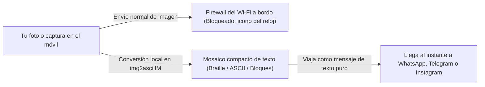
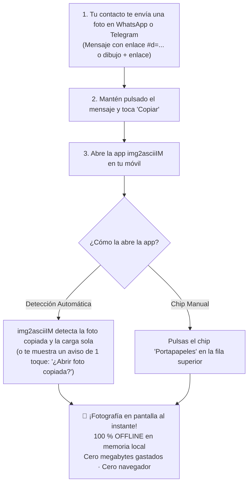
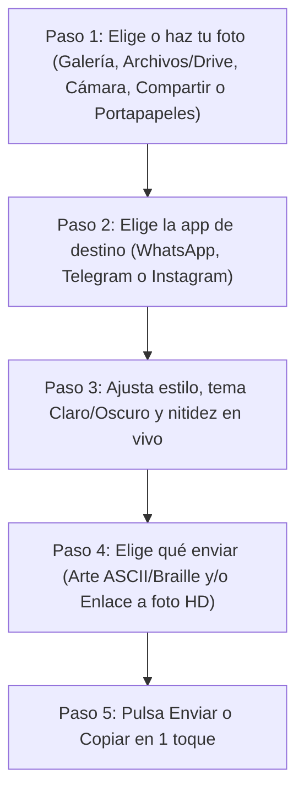
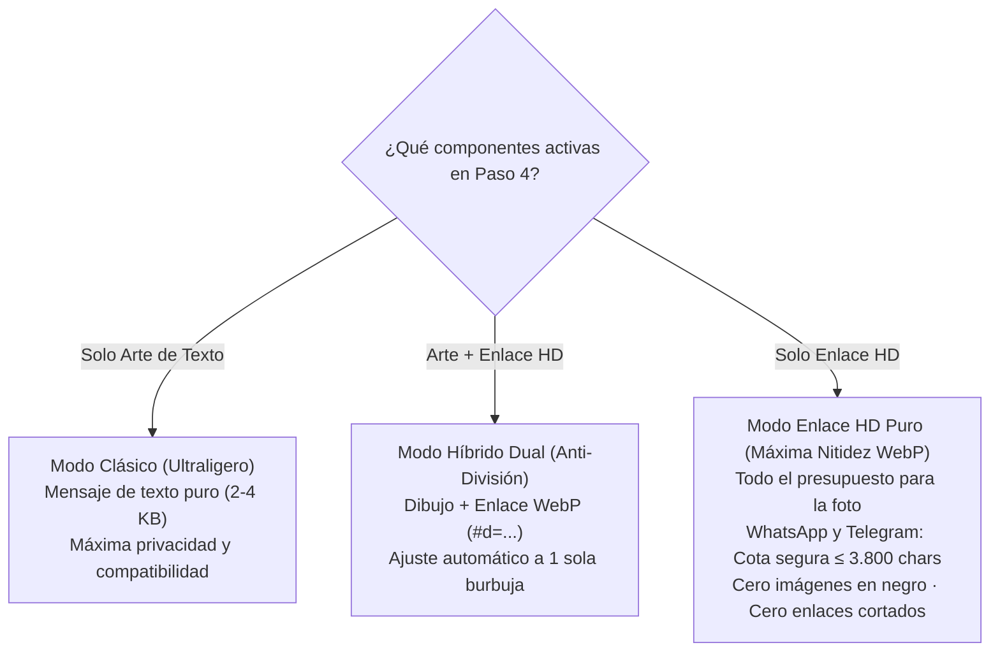
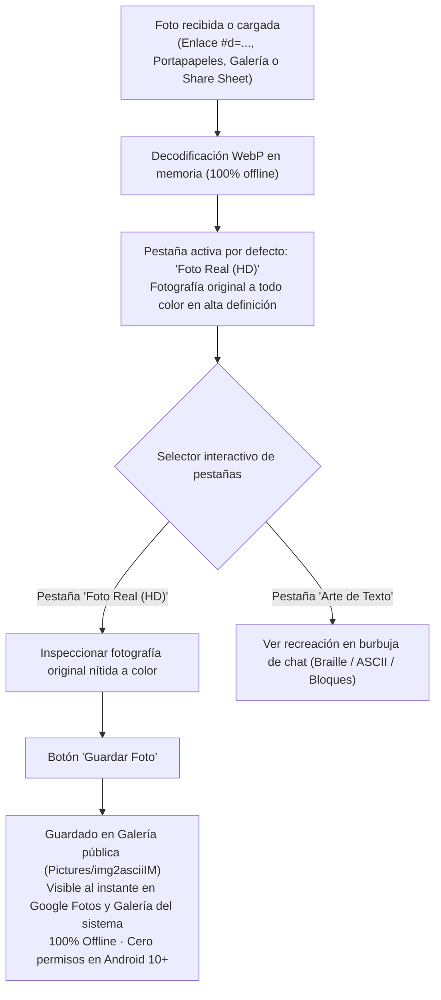
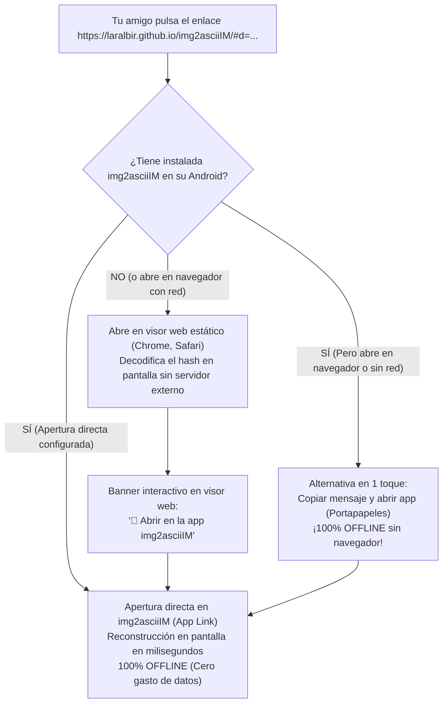

# Guía de Usuario de `img2asciiIM`


> **Comparte cualquier foto, captura o mapa como un mensaje de texto nítido por WhatsApp, Telegram o Instagram Direct cuando tu conexión bloquea las imágenes —100 % sin internet desde tu propio móvil.**

---

## Índice Rápido

1. [¿Qué es `img2asciiIM` y cuándo te salva el viaje?](#1-qué-es-img2asciiim-y-cuándo-te-salva-el-viaje)
2. [Consejo de Oro antes de Despegar (Archivos en la Nube y Google Drive)](#2-consejo-de-oro-antes-de-despegar-archivos-en-la-nube-y-google-drive)
3. [Cómo Abrir una Foto Compartida sin Internet ni Navegador (en Pleno Vuelo)](#3-cómo-abrir-una-foto-compartida-sin-internet-ni-navegador-en-pleno-vuelo)
4. [Cómo Activar que Android Abra los Enlaces Directamente en la App sin Pasar por Chrome](#4-cómo-activar-que-android-abra-los-enlaces-directamente-en-la-app-sin-pasar-por-chrome)
5. [Paso 1: Cómo Elegir o Capturar tu Imagen (5 Formas)](#5-paso-1-cómo-elegir-o-capturar-tu-imagen-5-formas)
6. [Paso 2: Elegir la App de Destino (WhatsApp, Telegram o Instagram)](#6-paso-2-elegir-la-app-de-destino-whatsapp-telegram-o-instagram)
7. [Paso 3: Ajustar el Estilo y la Nitidez (Recetas Rápidas)](#7-paso-3-ajustar-el-estilo-y-la-nitidez-recetas-rápidas)
8. [Paso 4: Elegir Qué Enviar (Arte de Texto y/o Enlace a Foto HD)](#8-paso-4-elegir-qué-enviar-arte-de-texto-yo-enlace-a-foto-hd)
9. [Paso 5: Enviar en 1 Toque o Copiar al Portapapeles](#9-paso-5-enviar-en-1-toque-o-copiar-al-portapapeles)
10. [Visualización de la Foto Real y Guardado en la Galería](#10-visualización-de-la-foto-real-y-guardado-en-la-galería)
11. [Cómo Funciona el Enlace HD Autónomo y el Visor Web (`#d=...`)](#11-cómo-funciona-el-enlace-hd-autónomo-y-el-visor-web-d)
12. [Comprobación y Actualizaciones In-App desde GitHub Releases](#12-comprobación-y-actualizaciones-in-app-desde-github-releases)
13. [Preguntas Frecuentes (FAQ) y Solución de Problemas Rápidos](#13-preguntas-frecuentes-faq-y-solución-de-problemas-rápidos)

---

## 1. ¿Qué es `img2asciiIM` y cuándo te salva el viaje?

¿Alguna vez te has conectado al **Wi-Fi gratuito de mensajería de un avión** (*Free Messaging*), al bono básico de un **crucero** o a una red móvil saturada en una **zona rural, estadio o montaña** y has intentado mandar una foto?

Seguramente viste cómo tus mensajes escritos llegaban al segundo con doble *check*, mientras que cualquier fotografía, captura de pantalla, audio o *sticker* se quedaba congelado indefinidamente con el **icono del reloj (*«Enviando…»*)**.

### ¿Por qué el texto llega al instante pero las fotos se quedan bloqueadas?

Las aplicaciones como **WhatsApp**, **Telegram** e **Instagram Direct** utilizan dos caminos distintos por dentro:
- **Un canal ultraligero de señalización** por el que viajan los mensajes de **texto puro** (ocupa apenas unos pocos kilobytes).
- **Servidores multimedia separados** para subir y descargar fotos, vídeos, notas de voz y *stickers*.

En vuelos comerciales (**Iberia**, **Vueling**, **Lufthansa**, **Delta Air Lines**, **United Airlines**, **Air Europa**, entre otras) y barcos de crucero, el router satelital autoriza el canal ligero de texto para que puedas chatear gratis, pero **bloquea los servidores multimedia y el resto de páginas web** para evitar que el enlace del avión se colapse:



**`img2asciiIM` resuelve este problema en segundos:** convierte cualquier fotografía, mapa del punto de encuentro, cartel de puerta de embarque, plaza de aparcamiento o vista desde la ventanilla en un **dibujo compacto hecho con caracteres de texto** (puntos Braille de alta precisión, arte ASCII clásico o bloques sombreados). Como para la red es un simple mensaje escrito, **atraviesa el Wi-Fi gratuito del avión al instante** y tu contacto reconoce la imagen directamente dentro de su burbuja de chat.

| Situación real | ¿Qué permite la red? | Cómo te ayuda `img2asciiIM` |
| :--- | :--- | :--- |
| **Wi-Fi gratuito en vuelos** (*Free Messaging* en Iberia, Vueling, Lufthansa, Delta, United, Air Europa…) | Solo mensajes de texto en apps de chat; fotos, audios y webs bloqueados. | Convierte tu foto sin internet y la envía como texto plano que llega en el acto. |
| **Cruceros y ferris** (bono básico de chat marítimo) | Texto básico por satélite; subida multimedia desactivada o carísima. | Comparte un selfie, horario de excursión o plano del barco sin pagar el pase multimedia completo. |
| **Montaña, festivales o cobertura rural mínima (`E` / `2G` / `3G` saturado)** | Los megabytes de una foto caducan por falta de señal, pero un texto corto sí sale. | Un mensaje de `img2asciiIM` ocupa **menos de 2 a 4 KB** (miles de veces menos que una foto de cámara). |

### Privacidad total: 100 % en tu móvil y cero permisos invasivos

> [!IMPORTANT]
> **Tus fotos jamás salen de tu teléfono para convertirse.**
> - **Sin conexión a internet (`100 % Offline`):** `img2asciiIM` ni siquiera solicita permiso de acceso a Internet en Android. Toda la conversión ocurre en milisegundos dentro del procesador de tu móvil, incluso con el **Modo Avión** activado.
> - **Sin acceso global a tu galería:** La aplicación nunca pide permiso para leer todas tus fotos o archivos privados. Utiliza los selectores seguros del sistema Android, por lo que únicamente recibe la imagen puntual que tú elijas en cada momento.

---

## 2. Consejo de Oro antes de Despegar (Archivos en la Nube y Google Drive)

`img2asciiIM` se lleva de maravilla con **Google Drive**, Microsoft OneDrive, Dropbox y las fototecas en la nube, pero hay un detalle fundamental que conviene conocer **antes de subir al avión**:

Cuando abres Google Drive o tu galería en la nube sin conexión, muchas veces **ves la miniatura pequeña** de tus archivos porque el móvil guarda esa vista previa, pero **el archivo real en alta calidad sigue guardado únicamente en internet**. Si ya estás a `10.000` metros de altura con el Wi-Fi gratuito del avión, el router bloqueará la descarga desde Google Drive y el archivo no podrá abrirse.

### Qué hacer en el aeropuerto antes de embarcar (30 segundos)

Si llevas en **Google Drive** (o en OneDrive / Dropbox) un plano del hotel, una captura de reserva, un mapa o cualquier imagen que quieras poder enviar durante el vuelo:

1. Abre la app **Google Drive** mientras aún tengas datos móviles o Wi-Fi en tierra.
2. Busca la imagen que te interese y pulsa el icono de tres puntos **`⋮`** a su derecha.
3. Activa la opción **«Disponible sin conexión»** (*Available offline*) —o pulsa **Descargar** para guardarla en tu carpeta local `Descargas`—.

| Origen de la imagen | En tierra (con datos o Wi-Fi normal) | En pleno vuelo (Modo Avión o Wi-Fi *Free Messaging*) |
| :--- | :---: | :--- |
| **Cámara del móvil** | Funciona siempre | **Funciona siempre al 100 %** |
| **Galería local y carpeta `Descargas`** | Funciona siempre | **Funciona siempre al 100 %** |
| **Tarjeta SD o pendrive USB-C** | Funciona siempre | **Funciona siempre al 100 %** |
| **Google Drive / OneDrive / Dropbox** *(marcado «Disponible sin conexión»)* | Funciona siempre | **Funciona siempre** *(se lee de la memoria local)* |
| **Google Drive / Fotos solo en la nube** *(sin descargar antes)* | Funciona (se descarga al momento) | **No disponible** *(el Wi-Fi del avión bloquea la nube)* |

> [!TIP]
> **¿Prefieres preparar tus mensajes con total calma?** Puedes hacer una foto por la ventanilla en **Modo Avión estricto**, ajustar el resultado en `img2asciiIM`, pulsar **Copiar** y conectarte al Wi-Fi del avión solo el instante necesario para pegar y enviar el texto.

---

## 3. Cómo Abrir una Foto Compartida sin Internet ni Navegador (en Pleno Vuelo)

Imagina esta situación habitual: estás en pleno vuelo conectado al **Wi-Fi satelital que solo autoriza mensajería de texto** (o incluso con el móvil en **Modo Avión**), tu compañero o familiar te envía una foto por WhatsApp o Telegram con un enlace HD (`#d=...`), pero al tocar el enlace **Android intenta abrir Google Chrome y te salta la pantalla de *"Sin conexión a internet"* o *"No se puede acceder a este sitio web"***.

El router del avión bloquea la navegación web, pero hay algo revolucionario: **la fotografía completa ya ha llegado a tu teléfono**, codificada dentro de las propias letras del mensaje de texto que acabas de recibir.

No necesitas que Chrome cargue ninguna página ni gastar saldo de datos. Puedes ver la fotografía original al instante siguiendo **tres pasos rápidos**:



### Los 3 Pasos Rápidos para Ver la Foto Sin Conexión:

1. **Copia el enlace o mensaje en tu chat:**  
   En WhatsApp o Telegram, mantén presionado el mensaje que te acaban de enviar y toca **«Copiar»** (o copia directamente la línea del enlace web).  
   > [!TIP]  
   > **Copia sin preocuparte por el formato:** Puedes copiar el mensaje completo aunque incluya el dibujo en caracteres Braille/ASCII y textos escritos de tu contacto. El analizador inteligente de `img2asciiIM` localiza y aísla automáticamente los datos de la imagen sin confundirse.

2. **Abre `img2asciiIM` en tu móvil:**  
   Al abrir la app o volver a ella desde la multitarea, la aplicación examina el portapapeles en milisegundos:
   - **Detección automática:** Si la app estaba en reposo o en la pantalla inicial limpia (*Empty State*), cargará la fotografía directamente. Si tenías otra conversión abierta, verás una notificación en pantalla preguntándote si deseas abrir la foto copiada.
   - **Chip manual «Portapapeles»:** También puedes pulsar en cualquier momento el chip interactivo **«Portapapeles»** situado en la barra superior de origen de imagen.

3. **¡La fotografía se muestra al instante sin conexión a internet!:**  
   El motor decodifica el formato WebP en tu procesador en menos de `150 ms`. La aplicación activa por defecto la pestaña **«Foto Real (HD)»**, mostrándote de inmediato la fotografía original a todo color con su máxima nitidez, lista para contemplar o pulsar **«Guardar Foto»** para almacenarla en tu galería (ver [Visualización de la Foto Real y Guardado en la Galería](#10-visualización-de-la-foto-real-y-guardado-en-la-galería)), sin necesidad de navegador, sin gastar megabytes de datos y funcionando al 100 % en Modo Avión.

---

## 4. Cómo Activar que Android Abra los Enlaces Directamente en la App sin Pasar por Chrome

¿Por qué al pulsar un enlace en WhatsApp o Telegram tu móvil intenta abrir Google Chrome en vez de saltar directamente a `img2asciiIM`?

En versiones modernas de Android (Android 12, 13, 14, 15+), el sistema operativo aplica una política estricta de seguridad: para que una aplicación intercepte enlaces web automáticamente (*Android App Links*), el sistema comprueba la configuración de **«Abrir de forma predeterminada»**. Si esa opción aún no está confirmada en tu teléfono, Android delega cualquier enlace web en Chrome. Estando en el avión o sin cobertura, Chrome intenta cargar la página por internet, falla y te muestra la pantalla de error.

### Cómo Configurarlo en 1 Minuto para Siempre:

Una vez configurado este ajuste, cada vez que toques un enlace `https://laralbir.github.io/img2asciiIM/#d=...` en cualquier chat, **se abrirá directamente dentro de `img2asciiIM` sin pasar jamás por Chrome**:

#### Opción A: Botón Directo desde `img2asciiIM`
1. Abre `img2asciiIM` y pulsa la opción **«Configurar enlaces nativos»** (disponible en el menú de opciones o en el diálogo de ayuda).
2. La app te llevará de forma automática a la pantalla de Ajustes del sistema de tu dispositivo.

#### Opción B: Desde los Ajustes de Android
1. Abre la aplicación **Ajustes** de tu teléfono Android.
2. Entra en el apartado **Aplicaciones** (o *Gestión de aplicaciones* / *Apps*).
3. Busca y pulsa **`img2asciiIM`** en la lista.
4. Toca en **«Abrir de forma predeterminada»** (*Open by default*).
5. Asegúrate de que el interruptor **«Abrir enlaces compatibles»** (*Open supported links*) esté activado (**SÍ**).
6. Entra en **«Enlaces compatibles» / «Añadir enlace»** y comprueba que esté marcado el dominio oficial:
   ```text
   laralbir.github.io
   ```

> [!IMPORTANT]
> **Ventaja definitiva:** Con este ajuste activo, ya no necesitarás ni copiar el mensaje: al pulsar el enlace en WhatsApp o Telegram en pleno vuelo, **Android saltará al instante a `img2asciiIM` y verás la foto al segundo**. Y si en algún momento no se abre solo, ¡siempre tienes la [solución de copiar y abrir con el portapapeles](#3-cómo-abrir-una-foto-compartida-sin-internet-ni-navegador-en-pleno-vuelo)!

---

## 5. Paso 1: Cómo Elegir o Capturar tu Imagen (5 Formas)

Al abrir **`img2asciiIM`**, te recibe una pantalla completamente limpia y despejada (**Empty State**), sin fotografías de muestra ni demostraciones artificiales. Desde el primer segundo dispones de un lienzo listo con accesos directos claros para elegir tu imagen:



Tienes **cinco maneras** igual de cómodas de cargar una imagen (y si abres cualquiera de ellas por error y pulsas *Atrás*, la imagen y los ajustes que ya tuvieras en pantalla se conservan intactos):

### 1. Botón «Galería»
Abre el selector moderno de fotos de Android para elegir cualquier imagen (`JPEG`, `PNG`, `WebP` o `HEIC`) de tu teléfono o de tu fototeca integrada. No importa si tu cámara hace fotos gigantescas de **48 MP o 108 MP** ni si hiciste la foto con el móvil girado: `img2asciiIM` reduce el tamaño de forma inteligente sin agotar la batería ni la memoria y **endereza automáticamente la orientación**.

### 2. Botón «Archivos / Drive»
Abre el explorador universal de documentos de Android. Es la opción ideal cuando la imagen no está en tu carrete de fotos habitual, sino en:
- Tu unidad de **Google Drive**, OneDrive, Dropbox o Nextcloud.
- La carpeta **`Descargas`** (por ejemplo, un plano descargado del correo o de la web de la aerolínea).
- Una **tarjeta microSD** o un **pendrive / lector de tarjetas USB-C** conectado al teléfono.

### 3. Botón «Cámara»
Dispara una foto al momento sin salir de `img2asciiIM`. Es perfecta durante el viaje para capturar:
- Las vistas de las alas, las nubes o el amanecer desde la **ventanilla del avión**.
- El panel luminoso con tu **puerta de embarque**, cinta de equipaje o vía de tren.
- El número de columna y planta donde dejaste el coche en el **parking del aeropuerto**.
- Un **mapa impreso** o cartel informativo.

*(Las capturas temporales de cámara se guardan únicamente en la caché privada de la app y se limpian automáticamente para no llenar el espacio de tu teléfono).*

### 4. Desde otra app con el menú «Compartir» (la vía más rápida para fotos propias)
Si ya tienes una imagen abierta en tu app de **Galería**, en **Google Drive** o en tu gestor de archivos:
1. Toca el botón estándar **Compartir** de Android.
2. Elige **`img2asciiIM`** en la lista de aplicaciones.
3. La aplicación se abrirá directamente con esa foto **ya convertida** en la vista previa, ahorrándote buscarla de nuevo.

### 5. Botón y Chip «Portapapeles» (Para fotos recibidas en WhatsApp o Telegram)
Si alguien te envió una foto convertida o un enlace `#d=...` en WhatsApp, Telegram o un correo:
1. **Copia el mensaje o enlace en el chat**.
2. Toca el chip **«Portapapeles»** en la fila superior de origen (o simplemente abre la app para que lo detecte de forma automática).
3. `img2asciiIM` lee el mensaje copiado, extrae la imagen y te la muestra al instante en pantalla sin salir al navegador y sin tocar internet.

---

## 6. Paso 2: Elegir la App de Destino (WhatsApp, Telegram o Instagram)

Cada aplicación de mensajería tiene sus propias reglas sobre **el tipo de letra** y **el tamaño máximo permitido por mensaje**. Si envías el mismo bloque de texto sin adaptarlo, en unas apps se verá torcido y en otras se cortará por la mitad.

Al tocar arriba **WhatsApp**, **Telegram** o **Instagram Direct**, `img2asciiIM` configura automáticamente todas las medidas internas por ti:

| App de Destino | Qué hace `img2asciiIM` automáticamente | Modo Inicial | Límite Seguro |
| :--- | :--- | :--- | :--- |
| **WhatsApp** *(y WhatsApp Business)* | Envuelve el dibujo en triple tilde ```` ```...``` ```` para activar la **letra monoespaciada** (ancho fijo), elimina símbolos que romperían el formato, ajusta el ancho a **`~32` columnas** para pantallas verticales y restringe los enlaces continuos por debajo de **`3.800` caracteres** para evitar el corte a 4.096 chars de WhatsApp. | **ASCII** *(admite Braille y Bloques)* | Hasta `65.536` caracteres multilínea *(enlaces `≤ 3.800`)* |
| **Telegram** | Ajusta automáticamente el tamaño para no superar jamás los **`4.096` caracteres** (fijando un tope de **`3.800` caracteres** en enlaces y `3.900` en mensajes híbridos para evitar que Telegram parta tu imagen en dos burbujas) y usa **Braille directo** (`~30` columnas) limpio y de alta resolución. | **Braille** *(admite ASCII y Bloques)* | **`4.096` caracteres** exactos |
| **Instagram Direct** | Desactiva los símbolos ```` ``` ```` (Instagram no los soporta), activa **Braille Unicode** con espacios especiales indestructibles (`⠀`) que mantienen la forma perfecta en la fuente normal de Instagram, y compacta el tamaño (`~22–24` columnas) por debajo de **`1.000` caracteres**. | **Braille** *(o Bloques)* | **`1.000` caracteres** estrictos |

### Detalles clave de cada plataforma

- **En WhatsApp:** WhatsApp exige el bloque ```` ``` ```` para alinear las columnas, pero tiene dos particularidades esenciales: (1) si el dibujo contiene una tilde invertida `` ` `` o empieza con espacios normales en blanco, WhatsApp desactiva el formato monoespaciado y desarma la imagen; (2) **WhatsApp y el sistema Android cortan cualquier enlace o token continuo sin espacios a los 4.096 caracteres exactos**. Por eso `img2asciiIM` filtra caracteres incompatibles y **limita todos los enlaces generados a un máximo de 3.800 caracteres**, evitando que WhatsApp corte el mensaje o muestre una imagen en negro al destinatario.
- **En Telegram:** Si intentas mandar una captura de pantalla muy alargada que supere `4.096` caracteres, Telegram normalmente corta el texto en dos burbujas separadas. `img2asciiIM` **recalcula las proporciones de forma automática** para que tu imagen entre siempre entera en **un único mensaje**. Además, si cambias manualmente a modo ASCII clásico, añade un salto de línea protector tras ```` ``` ```` para que Telegram no borre la primera fila confundiéndola con el nombre de un lenguaje de programación.
- **En Instagram Direct:** Instagram Direct no tiene letra monoespaciada (una `W` es mucho más ancha que un punto `.`) y además encoge los espacios normales. Por eso `img2asciiIM` utiliza el modo especial **Braille Unicode (`⠀..⣿`)**: Android dibuja todas las celdas Braille con el mismo ancho —incluida la celda vacía especial `⠀`— logrando que la imagen mantenga su geometría exacta dentro del estricto tope de `1.000` caracteres.

> [!WARNING]
> **Evita usar «ASCII clásico» en Instagram Direct.** Si seleccionas manualmente el modo ASCII teniendo elegido el perfil de Instagram, la app te mostrará un aviso porque la letra proporcional de Instagram desalineará las columnas. Para Instagram Direct, usa siempre **Braille** (máximo detalle) o **Bloques** (iconos sencillos de alto contraste).

---

## 7. Paso 3: Ajustar el Estilo y la Nitidez (Recetas Rápidas)

Justo encima de los controles verás la **Vista Previa de Burbuja**, que te muestra en tiempo real cómo quedará el mensaje junto con el contador de **`caracteres actuales / límite máximo`** y el tamaño en **`columnas × filas`**.

### A. Elige entre los 3 Estilos de Dibujo

- **Braille (`⠀..⣿`) — Máxima definición fotográfica:**
  Cada carácter es una rejilla de **8 micropuntos (`2 × 4`)**, lo que multiplica por ocho los detalles que caben en cada letra. Es la mejor opción para **rostros, selfies, paisajes desde la ventanilla, planos con calles y capturas detalladas**, y funciona de maravilla en las tres aplicaciones.
- **ASCII (`@#%...`) — El estilo retro clásico:**
  Construye la imagen combinando letras y signos clásicos (`@%#*+=-:.`). Es ideal en **WhatsApp** (o al copiar y pegar código en **Telegram**) cuando quieres ese aspecto informático auténtico de máquina de escribir.
- **Bloques (`█▓▒░`) — Trazos sólidos y alto impacto:**
  Rellena las zonas con bloques de distinta intensidad. Funciona genial para **logotipos, iconos grandes, señales de dirección, dibujos sencillos o siluetas muy contrastadas**.

### B. El truco maestro: Tema Claro vs. Tema Oscuro (Botón «Invertir»)

A diferencia de una foto normal, un mensaje de texto se pinta con el color de letra del teléfono de quien lo lee:
- En un móvil en **Modo Claro**, la burbuja de chat es clara (blanca o verde pálido) y las letras son **oscuras** (cuantos más puntos pones, más **oscura** se ve esa zona).
- En un móvil en **Modo Oscuro**, la burbuja es casi negra y las letras son **blancas** (cuantos más puntos pones, más **brillante** se ve esa zona).

Por eso, si envías un retrato pensado para fondo claro a alguien que usa Modo Oscuro, lo verá como el negativo de una foto antigua (pelo blanco y cara oscura).

1. Usa el **conmutador de vista previa (Burbuja Clara / Burbuja Oscura)** para simular la pantalla de tu amigo.
2. Activa o desactiva el botón **Invertir** según cómo use el móvil tu destinatario:
   - **Tu contacto usa Modo Claro:** deja **Invertir desactivado**.
   - **Tu contacto usa Modo Oscuro:** activa **Invertir**.

*(Si abres un logotipo o sticker `PNG` / `WebP` con fondo transparente, `img2asciiIM` adapta automáticamente el fondo transparente al modo elegido para que no aparezca un recuadro negro indeseado).*

### C. Brillo, Contraste, Ancho y Dithering (Tramado)

- **Ancho (columnas):** Controla cuántas letras ocupa cada fila a lo ancho (`12` a `72` columnas). El valor inicial ya viene calibrado para cada app (`32` en WhatsApp, `30` en Telegram, `22–24` en Instagram). Si tu contacto tiene un móvil pequeño o usa un tamaño de letra grande en Android, bájalo un poco para evitar que las líneas salten de renglón.
- **Brillo y Contraste:** Las fotos tomadas a través del cristal doble de la ventanilla del avión suelen salir algo blanquecinas o con neblina. Subir ligeramente el **Contraste** hace que las nubes, el ala o el horizonte destaquen al instante.
- **Dithering (Tramado de sombras):** Decide cómo se traducen los tonos grises suaves a puntos:
  - **Floyd-Steinberg:** Reparte los matices de forma suave y orgánica. Es el mejor para **caras, retratos, cielos y fotografías naturales**.
  - **Atkinson:** Marca mucho más los bordes y deja los fondos limpios sin ruido. Es espectacular para **mapas, carteles de aeropuerto, horarios, siluetas y retratos pequeños**.
  - **Sin tramado (`Ninguno`):** Aplica un corte directo blanco/negro. Úsalo para **logotipos limpios, dibujos en blanco y negro o iconos planos**.

### Tabla de Recetas Rápidas

| Qué quieres enviar | Estilo recomendado | Dithering (Tramado) | Consejo extra |
| :--- | :--- | :--- | :--- |
| **Selfie o foto de personas** | **Braille (`⠀..⣿`)** | **Floyd-Steinberg** | Acerca o encuadra bien las caras y ajusta **Invertir** según el tema (claro/oscuro) de tu contacto. |
| **Vistas desde la ventanilla (alas, nubes, puesta de sol)** | **Braille (`⠀..⣿`)** | **Floyd-Steinberg** | Sube un poco el **Contraste** para compensar el reflejo del cristal del avión. |
| **Mapa de punto de encuentro, cartel o puerta de embarque** | **Braille (`⠀..⣿`)** | **Atkinson** | El tramado *Atkinson* perfila letras grandes, flechas y calles con mucha mayor claridad. |
| **Estilo retro en un grupo de WhatsApp** | **ASCII (`@#%...`)** | **Floyd-Steinberg** o **Atkinson** | Mantén el ancho entre `28` y `32` columnas para que todos en el grupo lo vean sin cortes. |
| **Logo, bandera, señal o silueta fuerte** | **Bloques (`█▓▒░`)** | **Sin tramado** *(o Atkinson)* | Contraste alto para conseguir bloques limpios y reconocibles al primer golpe de vista. |

---

## 8. Paso 4: Elegir Qué Enviar (Arte de Texto y/o Enlace a Foto HD)

Justo debajo de los controles de nitidez encontrarás la sección **Componentes del mensaje**, que te permite decidir exactamente qué quieres incluir en el chat mediante dos casillas independientes:

- **`[x] Incluir arte de texto (ASCII / Braille)`**
- **`[x] Adjuntar enlace a foto HD (#d=...)`**



### Los 3 Modos de Envío según tu Necesidad

#### 1. Modo Clásico: Solo Arte de Texto *(Opción por Defecto)*
- **Ajuste:** `[x] Incluir arte de texto` activado · `[ ] Adjuntar enlace a foto HD` desactivado.
- **Resultado:** Tu mensaje se compone únicamente del dibujo en puntos Braille, caracteres ASCII o bloques.
- **Cuándo usarlo:** Cuando quieras enviar un mensaje ultraligero (apenas `2` a `4 KB`), sin enlaces web de ningún tipo, perfecto para el canal de texto más básico del avión o cuando tu contacto solo necesita ver el dibujo en su pantalla al instante.

#### 2. Modo Híbrido Dual: Arte de Texto + Enlace a Foto HD *(Garantía Anti-División)*
- **Ajuste:** `[x] Incluir arte de texto` activado · `[x] Adjuntar enlace a foto HD` activado.
- **Resultado:** El mensaje muestra el dibujo en texto en la burbuja del chat seguido de un salto de línea con el enlace canónico abreviado `#d=`:
  ```text
  <dibujo en braille o ascii>
  https://laralbir.github.io/img2asciiIM/#d=...
  ```
- **Sin textos superfluos:** Se eliminan cadenas decorativas como `"📸 Ver foto..."` o `"🔗 Ver foto..."`, ahorrando decenas de caracteres para dar más nitidez a la imagen.
- **Garantía Anti-División en Telegram:** Telegram corta cualquier mensaje que supere los 4.096 caracteres, dividiéndolo en dos burbujas separadas. `img2asciiIM` lo evita por completo: fija un **presupuesto máximo de 3.900 caracteres** y calcula automáticamente:
  $$\text{Presupuesto Enlace} = \min(3.800, 3.900 - \text{Longitud del Arte} - 1)$$
  Si tu dibujo es grande, el codificador reduce la resolución y la calidad WebP de la foto al vuelo para que la suma total **quepa siempre dentro de un único mensaje de chat**.

#### 3. Modo Enlace HD Puro: Máxima Nitidez Fotográfica *(Sin Arte de Texto)*
- **Ajuste:** `[ ] Incluir arte de texto` desactivado · `[x] Adjuntar enlace a foto HD` activado.
- **El secreto:** Al apagar el dibujo de texto, **todo el presupuesto de caracteres de la app de mensajería se dedica íntegramente a la fotografía incrustada en el enlace**.
- **Códec WebP Lossy y Cota Universal Segura (`MAX_SAFE_URL_LENGTH = 3.800` caracteres):** Gracias al formato moderno WebP Lossy, las imágenes ocupan casi la mitad que en JPEG a la misma calidad visual:
  - **Límite duro de WhatsApp (4.096 caracteres continuos):** Aunque WhatsApp permite textos con saltos de línea de hasta 65.536 caracteres, **la aplicación WhatsApp y Android truncan automáticamente a los 4.096 caracteres cualquier enlace continuo sin espacios**. Si un enlace supera los 4.096 caracteres, WhatsApp recorta los caracteres del final, rompiendo el archivo WebP y provocando que el receptor vea una **imagen en negro o dañada**.
  - **La solución infalible de `img2asciiIM`:** Todos los enlaces generados se mantienen estrictamente por debajo de los **`3.800` caracteres** (`MAX_SAFE_URL_LENGTH`). Con este margen de casi 300 caracteres de seguridad frente al corte de 4.096 chars, **WhatsApp jamás corta el enlace ni muestra imágenes en negro**.
  - **En WhatsApp:** `img2asciiIM` adapta la resolución y calidad WebP al vuelo mediante reducción adaptativa, garantizando que el enlace quepa íntegro bajo los `3.800` caracteres con excelente nitidez.
  - **En Telegram:** Se ajusta igualmente a la cota de **`3.800` caracteres** (y un presupuesto combinado de `3.900` chars en modo híbrido con arte de texto), garantizando que llegue siempre en una **única burbuja sin fragmentarse**.
- **El resultado en el chat:** Tu mensaje queda completamente limpio y directo, compartiendo únicamente la URL:
  ```text
  https://laralbir.github.io/img2asciiIM/#d=...
  ```

> [!TIP]
> **Salvaguarda de mensaje no vacío:** La aplicación nunca te dejará desmarcar las dos casillas a la vez. Si intentas apagar la última que queda encendida, el sistema mantendrá activa una de ellas para garantizar que jamás mandes un mensaje en blanco por error.

> [!NOTE]
> **¿Por qué en Instagram Direct el enlace HD aparece desactivado?**
> Instagram Direct impone un límite estricto de **`1.000` caracteres / 1.000 bytes** por mensaje de texto. En un espacio tan reducido es matemáticamente imposible incrustar una fotografía en Base64 sin recortarla. Por eso, en el perfil de Instagram la app desactiva automáticamente el conmutador de enlace HD y prioriza el arte en Braille de alta precisión, que luce espectacular y respeta los `1.000` caracteres al milímetro.

---

## 9. Paso 5: Enviar en 1 Toque o Copiar al Portapapeles

Cuando la vista previa de burbuja y los componentes seleccionados se vean a tu gusto, tienes dos acciones directas en la parte inferior:

### Opción A: Botón «Enviar a WhatsApp / Telegram / Instagram»
- Lanza directamente la aplicación de mensajería seleccionada con tu mensaje preparado para que solo tengas que **tocar el chat de tu contacto y pulsar Enviar**.
- Si utilizas una variante oficial (como **WhatsApp Business** o **Telegram X**) o en ese teléfono no tienes instalada esa aplicación concreta, `img2asciiIM` abrirá automáticamente el menú estándar **Compartir** de Android para que puedas enviarlo por cualquier otra vía sin errores.

> [!NOTE]
> **Entrega Segura Clipboard-First en WhatsApp (Fotos de Gran Resolución):**
> WhatsApp admite mensajes gigantescos de hasta `65.536` caracteres. Sin embargo, en algunas versiones de Android o de WhatsApp, el sistema de intercambio de datos entre aplicaciones (`Intent`) puede llegar a recortar textos extremadamente largos.  
> Para que nunca pierdas ni un solo píxel, `img2asciiIM` aplica la técnica **Clipboard-First**: **guarda automáticamente todo el mensaje en el portapapeles** antes de abrir WhatsApp y te muestra un aviso en pantalla. Si al abrir el chat ves que WhatsApp ha recortado el enlace, solo tienes que **mantener pulsado el campo de escritura y tocar «Pegar»**. ¡Tu mensaje íntegro aparecerá de inmediato!

> [!NOTE]
> **¿Cómo funciona el envío rápido a Instagram Direct (*Copiado Automático*)?**
> Por limitaciones propias de la app de Instagram en Android, algunas versiones abren la lista de chats pero ignoran los textos externos cuando no contienen un enlace web tradicional.
> Para que nunca pierdas un segundo, al pulsar **«Enviar a Instagram»**, `img2asciiIM` **guarda siempre primero tu arte en el portapapeles de forma automática** antes de abrir Instagram:
> 1. Si Instagram rellena el mensaje solo, simplemente elige a tu contacto y envíalo.
> 2. Si Instagram abre tus mensajes directos en blanco, entra en el chat de la persona, **mantén pulsado el cuadro *«Enviar mensaje…»*** y toca **Pegar**. ¡Tu imagen en Braille aparecerá entera y lista para enviar!

### Opción B: Botón «Copiar»
- Copia el resultado exacto al portapapeles de Android en **1 solo toque** (notarás una suave vibración de confirmación y el aviso en pantalla).
- Es comodísimo cuando:
  - Ya tienes la conversación abierta en segundo plano y prefieres cambiar de app y pegar manualmente.
  - Quieres pegar el dibujo o el enlace en **otra app compatible con el Wi-Fi del avión** (como Facebook Messenger, Google Messages, Signal, Slack o notas personales).
  - En **Telegram** has elegido expresamente el modo **ASCII clásico** con bloque ```` ``` ```` y quieres pegarlo directamente en la caja de escritura del chat para que Telegram aplique el formato de código al instante.

---

## 10. Visualización de la Foto Real y Guardado en la Galería

Uno de los mayores avances de `img2asciiIM` es que no solo te permite convertir fotos a caracteres de texto: cuando recibes un enlace (`#d=...`), abres una imagen compartida o importas desde el portapapeles, la aplicación **reconstruye la fotografía real a todo color en alta definición** y te permite guardarla directamente en el carrete de tu teléfono.



### Visualización Inmediata en Alta Definición al Abrir o Copiar un Enlace

Cuando tu contacto te envía una foto a través del Wi-Fi del avión (como mensaje con enlace `#d=...`) y lo abres mediante **App Link nativo** o lo copias en WhatsApp/Telegram y abres la app (ingesta desde **Portapapeles**):

1. **Apertura directa en Foto Real:** La aplicación detecta el payload WebP, lo decodifica en milisegundos en la memoria local de tu teléfono y **activa automáticamente la pestaña «Foto Real (HD)» como vista predeterminada**.
2. **Cero esperas:** No necesitas pulsar botones adicionales ni activar modos especiales: la fotografía real a todo color aparece inmediatamente en el centro de la pantalla, con la misma resolución y tonalidades del archivo original.
3. **100 % sin conexión:** Todo el renderizado se completa en tu procesador en menos de 150 ms sin requerir datos móviles, sin consultar servidores externos y funcionando al 100 % en Modo Avión.

### El Selector Interactivo de Pestañas: «Foto Real (HD)» vs. «Arte de Texto»

Justo encima de la pantalla de visualización encontrarás un selector con dos pestañas interactivas diseñadas para ofrecerte lo mejor de los dos mundos:

- **Pestaña «Foto Real (HD)»:**
  - Muestra el **bitmap original a todo color** en alta fidelidad.
  - Ajusta la imagen de manera óptima a la pantalla (`Fit`) preservando su relación de aspecto original, sobre una superficie de alto contraste que facilita apreciar rostros, carteles, mapas o paisajes.
  - Ofrece acceso directo al botón **«Guardar Foto»** para descargar la imagen en tu almacenamiento.

- **Pestaña «Arte de Texto»:**
  - Muestra la **burbuja de chat interactiva** con el dibujo en caracteres de texto (**Braille Unicode `⠀..⣿`**, **ASCII clásico** o **Bloques**).
  - Permite simular el fondo de tu aplicación de mensajería (conmutador **Burbuja Clara / Burbuja Oscura**).
  - Muestra las dimensiones exactas (`columnas × filas`) y el contador de caracteres frente al límite de la app seleccionada (`WhatsApp`, `Telegram` o `Instagram`).
  - Habilita los controles de edición en vivo (brillo, contraste, ancho en columnas, tramado *dithering* e inversión de tema).

Puedes alternar entre ambas pestañas tantas veces como quieras con un solo toque, comparando la foto original con su versión en arte de texto.

### Guardar la Foto en la Galería en 1 Toque (`Pictures/img2asciiIM`)

Si has recibido una foto importante de un viaje (un plano de metro, una tarjeta de embarque, la reserva del hotel o una foto familiar) y quieres conservarla en tu teléfono para siempre o editarla en otra aplicación, no necesitas hacer capturas de pantalla:

1. Pulsa el botón **«Guardar Foto»** (con icono de descarga/disco) situado en el visor de Foto Real o en la barra de acciones.
2. La app escribe el mapa de bits decodificado directamente en el almacenamiento público del dispositivo a través de la API oficial **`MediaStore`** de Android.
3. **¿Dónde se guarda?** La imagen se almacena en la carpeta estándar:
   ```text
   Pictures/img2asciiIM/
   ```
4. **Indexación inmediata:** La foto aparece al instante en **Google Fotos**, en la app **Galería** de Samsung, Xiaomi, Motorola, Pixel o cualquier fabricante, dentro del álbum **img2asciiIM**.

> [!IMPORTANT]
> **Privacidad y cero permisos en Android 10+ (API 29+):**  
> Gracias a la integración con `MediaStore` y el modelo de almacenamiento seguro (*Scoped Storage*) de Android moderno, **`img2asciiIM` NO solicita ningún permiso de almacenamiento en tiempo de ejecución**. La aplicación guarda la imagen en la galería pública sin pedir acceso a tus fotos personales ni a tus archivos privados. Además, el guardado se ejecuta **100 % offline** en segundo plano, sin consumir batería ni congelar la interfaz.

---

## 11. Cómo Funciona el Enlace HD Autónomo y el Visor Web (`#d=...`)

Tal vez te preguntes: *¿Cómo es posible enviar una foto dentro de un enlace web si el Wi-Fi del avión tiene bloqueada la subida de fotos y no me deja navegar por páginas web?*

### El Secreto: La Imagen Viaja DENTRO de las Letras del Enlace

En un sistema convencional de internet, para mandar una foto tienes que subirla a un servidor (Google Drive, Imgur, servidores de WhatsApp) y mandar un enlace a ese servidor (`https://servidor.com/mi-foto.jpg`). En el avión, ese servidor está bloqueado, por lo que la foto nunca llega.

En cambio, `img2asciiIM` genera un **enlace 100 % autónomo y autosuficiente**:

```text
https://laralbir.github.io/img2asciiIM/#d=UklGRvAAAABXRUJQVlA4...
```

1. Toda la fotografía se comprime en el formato ultraligero **WebP Lossy** y se traduce a una secuencia de caracteres llamada **Base64 URL-safe**.
2. Esa secuencia se coloca detrás del identificador corto **`#d=`** (*hash fragment*).
3. Para el router del avión y para la aplicación de chat, ese enlace es simplemente **un mensaje de texto plano ordinario**, por lo que **atraviesa el cortafuegos satelital sin ningún bloqueo**.
4. La parte detrás del `#` jamás se transmite a ningún servidor de internet ni a terceros: se procesa íntegramente en el dispositivo de quien abre el enlace.

> [!IMPORTANT]
> **Límite Seguro de 3.800 Caracteres y Guardia de Integridad RIFF WebP:**
> - **¿Por qué los enlaces se mantienen estrictamente bajo los 3.800 caracteres?**  
>   Aunque WhatsApp permite mensajes de texto largos con saltos de línea, **WhatsApp y el sistema Android aplican un truncamiento duro e implacable a los 4.096 caracteres continuos** (cadenas sin espacios). Si un enlace superase ese tamaño, WhatsApp lo cortaría de inmediato al enviarlo o pegarlo, perdiendo los bytes finales del archivo WebP y provocando que el receptor vea una **imagen completamente en negro o dañada**. Al limitar cualquier enlace generado a un máximo estricto de **`3.800` caracteres** (`MAX_SAFE_URL_LENGTH`), `img2asciiIM` garantiza un margen de seguridad de casi 300 caracteres que hace al enlace 100 % inmune a recortes en WhatsApp y a divisiones de burbuja en Telegram.
> - **Guardia de Integridad RIFF WebP en Recepción:**  
>   Al abrir o importar cualquier enlace (desde el portapapeles o mediante App Link), `img2asciiIM` inspecciona la cabecera del archivo WebP y comprueba que el tamaño real recibido coincida con el tamaño declarado en el contenedor RIFF. Si detecta que faltan datos (por ejemplo, porque un cliente antiguo de WhatsApp cortó el enlace a los 4.096 caracteres), la aplicación te avisa con un mensaje explicativo claro en lugar de intentar pintar una imagen en negro o deformada.

### Qué Ocurre Cuando tu Amigo Abre el Enlace (y Cómo Abrirlo en la App)

El enlace funciona para cualquier persona y en cualquier dispositivo:



#### 1. Si tu contacto tiene `img2asciiIM` instalada en Android:
- **Apertura Directa por App Link:** Android detecta automáticamente el enlace (`Intent.ACTION_VIEW`), abre la app de inmediato, extrae los datos y **dibuja la fotografía original en alta definición a todo color**, sin necesidad de internet y sin gastar ni un solo megabyte de datos.
- **¿Qué pasa si el enlace se abrió dentro del navegador de Telegram o Chrome y da error de conexión?**
  No te preocupes en absoluto:
  1. Si Chrome llegó a abrir la página, pulsa el botón superior **«📱 Abrir en la app img2asciiIM»** para pasarla a la app nativa.
  2. Si estás en Modo Avión o el Wi-Fi satelital bloquea Chrome, aplica el flujo infalible: **copia el mensaje en el chat y abre `img2asciiIM`** (la app lo detectará automáticamente o tocando el chip **«Portapapeles»**; ver [Sección 3](#3-cómo-abrir-una-foto-compartida-sin-internet-ni-navegador-en-pleno-vuelo)).
  3. Para que la próxima vez Android no intente abrir Chrome, activa los enlaces nativos en Ajustes (ver [Sección 4](#4-cómo-activar-que-android-abra-los-enlaces-directamente-en-la-app-sin-pasar-por-chrome)).

#### 2. Si tu contacto no tiene la app instalada (o usa iPhone, iPad o PC):
- El enlace se abre en su navegador web habitual (Safari, Chrome, Edge, Firefox).
- Una página web estática ultraligera alojada en GitHub Pages lee el fragmento `#d=...` con JavaScript directamente en el navegador del usuario y **proyecta la fotografía en pantalla** en menos de una décima de segundo, ofreciendo además un botón directo para descargar el APK firmado en Android si lo desea.

---

## 12. Comprobación y Actualizaciones In-App desde GitHub Releases

`img2asciiIM` es un proyecto de software libre y privado que no depende de los servicios privativos de **Google Play Store**. Para que siempre disfrutes de las últimas mejoras y correcciones sin complicaciones, la aplicación incluye su propio **sistema nativo de comprobación y actualización in-app**:

### Cómo Comprobar si Hay una Versión Nueva

1. Toca el menú de tres puntos o el botón **«Comprobar actualizaciones»** en la barra superior de `img2asciiIM`.
2. La app consultará de forma segura el repositorio oficial en GitHub (`https://api.github.com/repos/laralbir/img2asciiIM/releases/latest`).
3. Si estás usando la última versión, verás un mensaje confirmando que tu versión (`v1.0.0`) está al día.
4. Si hay una versión más moderna disponible (por ejemplo, `v1.1.0`), aparecerá una tarjeta con:
   - El número de versión nueva.
   - Las **notas de la versión** explicando qué mejoras incluye.
   - Un botón **«Descargar APK»** que descarga directamente el instalador oficial firmado.

### Resiliencia Total en Modo Avión y Vuelos

> [!IMPORTANT]
> **Cero fallos ni congelaciones en pleno vuelo:**
> Si pulsas comprobar actualizaciones mientras estás en **Modo Avión**, en el desierto o conectado al Wi-Fi del avión (que suele bloquear el acceso a las APIs de GitHub), la aplicación aplica un tiempo límite ultracorto (**4 segundos**) y cancela la petición silenciosamente con un aviso amigable (*«Sin conexión para comprobar actualizaciones»*). La app jamás se bloquea, no muestra errores técnicos ni interrumpe la conversión de tus fotos.

### Seguridad y Verificación Criptográfica (SHA-256)

Cada actualización oficial de `img2asciiIM` se compila y firma automáticamente mediante un flujo verificado de **Integración Continua (CI/CD)** en GitHub Actions:
- Cada archivo APK publicado viene acompañado de su archivo de suma criptográfica **`SHA-256`** (`img2asciiIM-vX.Y.Z.apk.sha256`).
- Esto garantiza que el instalador que descargas es exactamente el mismo que se compiló a partir del código fuente público, sin modificaciones de terceros ni malware.

---

## 13. Preguntas Frecuentes (FAQ) y Solución de Problemas Rápidos

### «¿Qué hago si al tocar un enlace en WhatsApp o Telegram se abre Chrome y da error de conexión en el avión?»
**Causa:** Android intenta abrir los enlaces web `https://...` en Chrome de forma predeterminada, pero el Wi-Fi satelital del avión bloquea la navegación web ordinaria.  
**Solución inmediata (¡en 2 segundos sin internet!):** Mantén pulsado el mensaje o enlace en el chat, toca **«Copiar»** y abre **`img2asciiIM`**. La app detectará la foto en tu portapapeles o solo tendrás que pulsar el chip **«Portapapeles»** para verla al instante 100 % offline.  
**Solución definitiva:** Activa la apertura nativa en los Ajustes de Android (ver [Cómo Activar que Android Abra los Enlaces Directamente en la App sin Pasar por Chrome](#4-cómo-activar-que-android-abra-los-enlaces-directamente-en-la-app-sin-pasar-por-chrome)) para que los enlaces se abran siempre directamente en la app sin pasar por Chrome.

---

### «Al usar el botón o chip "Portapapeles", ¿es privado? ¿Guarda `img2asciiIM` mis mensajes o textos privados?»
**Privacidad absoluta y efímera.** `img2asciiIM` analiza el portapapeles única y exclusivamente para buscar si contiene un enlace o payload fotográfico de la app (`#d=...`). Si copiaste un mensaje que incluía texto de conversación, comentarios o datos personales, la aplicación **jamás guarda, no registra ni transmite nada a ningún servidor**. Todo el procesado ocurre en la memoria volátil de tu propio teléfono y se destruye al cerrar la app.

---

### «¿Dónde se guardan las fotos al pulsar "Guardar Foto" y qué permisos necesita?»
**En tu galería oficial sin ningún permiso invasivo.**  
- **Ubicación en tu móvil:** Las imágenes se guardan directamente en el directorio estándar de medios de Android: `Pictures/img2asciiIM/`. Al guardarse, aparecen inmediatamente indexadas en **Google Fotos** y en la app **Galería** de tu móvil dentro del álbum *img2asciiIM*.
- **Cero permisos en Android 10+:** Gracias a la API moderna `MediaStore` y al almacenamiento aislado (*Scoped Storage*), la aplicación puede guardar sus propias fotos en tu galería pública sin pedirte ningún permiso peligroso de lectura ni acceso global a tus fotos privadas.
- **100 % sin internet:** La imagen se extrae del archivo WebP en memoria y se guarda en tu disco local sin conectarse a internet, funcionando a la perfección en Modo Avión.

---

### «¿El enlace de foto HD gasta datos de mi bono satelital o del Wi-Fi del avión?»
**Cero datos extra.** Como la foto va codificada en texto dentro del propio enlace, viaja por el canal de texto plano autorizado por la aerolínea. Al enviarlo no se conecta a servidores multimedia, y cuando el destinatario tiene la app instalada, la imagen se reconstruye en su memoria sin descargar nada de internet.

---

### «¿Por qué se ve mejor la foto cuando apago el conmutador de arte de texto?»
Al desactivar el arte de texto (ASCII / Braille), el mensaje no tiene que reservar caracteres para dibujar filas de puntos. Todo el cupo disponible dentro del límite seguro (**`3.800` caracteres**, para evitar que WhatsApp corte los enlaces o Telegram divida el mensaje) pasa a dedicarse íntegramente a la foto del enlace, permitiendo a la app comprimir la imagen en **WebP Lossy** con mayor resolución y una nitidez fotográfica visiblemente superior sin riesgo de cortes.

---

### «¿Por qué los enlaces generados ahora se mantienen bajo los 3.800 caracteres si WhatsApp permite mensajes de hasta 65.536 caracteres?»
**Causa:** WhatsApp tolera mensajes de texto extensos (hasta 65.536 caracteres) cuando el texto está compuesto por palabras ordinarias y saltos de línea. Sin embargo, **tanto WhatsApp como la pila del sistema Android aplican un corte forzado a los 4.096 caracteres exactos ante cualquier palabra o enlace continuo sin espacios en blanco**.  
Si un enlace sobrepasara los 4.096 caracteres, WhatsApp lo cortaría de forma destructiva al enviarlo o pegarlo. Al perderse los caracteres finales de la cadena Base64, el archivo WebP queda corrupto y el destinatario experimenta un fallo de apertura o una desconcertante **pantalla o imagen en negro**.  
**La solución:** `img2asciiIM` fija una cota universal de seguridad de **`MAX_SAFE_URL_LENGTH = 3.800` caracteres** para todas las aplicaciones y modos. Este margen de seguridad de casi 300 caracteres garantiza que ningún enlace sufra cortes, no provoque imágenes en negro y tampoco se divida en dos burbujas en Telegram (cuyo tope de mensaje también es 4.096 chars).

---

### «¿Qué hago si recibo un enlace cortado o con imagen en negro enviado desde una versión antigua?»
**Causa:** En versiones previas de la app (o si alguien comparte un enlace sin respetar la cota de 3.800 caracteres), WhatsApp truncó los datos de la imagen al alcanzar su límite duro de 4.096 caracteres continuos. En receptores antiguos, el decodificador de Android intentaba procesar el flujo incompleto y mostraba un recuadro o imagen completamente en negro.  
**Protección actual en `img2asciiIM`:** La aplicación incluye una **guardia de integridad de cabecera RIFF WebP**: al importar el enlace desde el portapapeles o abrirlo como App Link, la app compara el tamaño recibido con los bytes declarados en la cabecera. Si detecta que el enlace fue cortado a los 4.096 caracteres, bloquea la decodificación fallida y te muestra un aviso claro: *«El enlace recibido fue truncado por la aplicación de mensajería (límite de 4.096 caracteres)»*.  
**Solución recomendada:**
1. **Actualizar la app:** Pide a tu contacto que actualice `img2asciiIM` a la última versión disponible (a través del botón «Comprobar actualizaciones» o desde GitHub Releases).
2. **Reenviar la foto:** Desde la versión actualizada, todos los enlaces generados se adaptan automáticamente para mantenerse bajo los 3.800 caracteres y llegarán enteros sin cortes.
3. **Alternativa inmediata en vuelo:** Si tu contacto no puede actualizar en ese instante, pídele que desactive el conmutador de enlace HD y te mande la imagen en **Solo Arte de Texto (Braille o ASCII)**. El texto con saltos de línea no sufre el límite de 4.096 caracteres de enlaces continuos y atravesará el chat a la perfección.

---

### «¿Por qué Telegram nunca divide mis mensajes largos en dos burbujas de chat?»
Telegram impone un límite estricto de `4.096` caracteres por mensaje y parte en dos cualquier texto que lo supere. `img2asciiIM` aplica una **garantía anti-división**: fija un tope máximo de **`3.900` caracteres** y, cuando combinas arte de texto y enlace HD, calcula dinámicamente `3.900 - art.length - 1`, ajustando la resolución y calidad de la foto para que la suma total quepa de forma garantizada en un **único mensaje continuo**.

---

### «¿Por qué al enviar a WhatsApp me avisa de que el mensaje se copió al portapapeles?»
WhatsApp permite mensajes de hasta `65.536` caracteres, pero algunas versiones de Android o del propio WhatsApp pueden recortar textos extensos cuando se envían a través del menú Compartir (`Intent`). Para evitar cualquier pérdida, `img2asciiIM` utiliza la estrategia **Clipboard-First**: copia el mensaje íntegro a tu portapapeles antes de abrir WhatsApp. Si WhatsApp no pega el texto completo en el chat, solo tienes que **mantener pulsado y darle a Pegar**.

---

### «¿Cómo abro una foto en la app de `img2asciiIM` si el enlace se me abrió en el navegador web?»
Si tocas un enlace `#d=...` en un chat y se abre en Chrome o en el navegador interno de Telegram en lugar de en la app, fíjate en la parte superior de la página: verás un banner que dice **«¿Tienes la app instalada en tu móvil? 📱 Abrir en la app img2asciiIM»**. Al tocarlo, el navegador llamará al esquema nativo `img2asciiim://` y abrirá la imagen al instante dentro de tu app 100% offline.

---

### «Mi amigo me dice que ve las líneas partidas en dos renglones o la imagen "descuadrada"»
**Causa:** Cada fila de tu dibujo es un poquito más ancha que la burbuja de chat del móvil de tu amigo (ocurre cuando su teléfono tiene la pantalla estrecha o lleva activada la opción de **Tamaño de fuente grande** en los ajustes de accesibilidad de Android/iPhone).  
**Solución rápida:** Baja el deslizador de **Ancho** unas `4` o `6` columnas (por ejemplo, ponlo en **`24–26` columnas** para WhatsApp/Telegram o **`18–20` columnas** para Instagram Direct) y vuelve a enviarlo. Se verá perfectamente alineado en cualquier pantalla.

---

### «La imagen se reconoce, pero se ve rara, como en negativo (las caras oscuras y el fondo brillante)»
**Causa:** Estás enviando la imagen con el ajuste pensado para Modo Claro a alguien que tiene el móvil en **Modo Oscuro** (o viceversa).  
**Solución rápida:** Toca el botón **Invertir** en el Paso 3 y comprueba el resultado cambiando el interruptor **Claro / Oscuro** de la vista previa antes de reenviarlo.

---

### «Intento abrir un archivo de Google Drive en mitad del vuelo y dice que no está disponible sin conexión»
**Causa:** Aunque Google Drive te muestre la miniatura del archivo en la lista, la imagen completa nunca llegó a descargarse en la memoria interna de tu móvil antes del despegue, y el Wi-Fi gratuito del avión bloquea la conexión con los servidores de Google Drive.  
**Solución:**
- **Para el próximo vuelo:** Marca tus documentos importantes con **«Disponible sin conexión»** dentro de Google Drive antes de embarcar (ver [Consejo de Oro antes de Despegar](#2-consejo-de-oro-antes-de-despegar-archivos-en-la-nube-y-google-drive)).
- **Si ya estás volando:** Comprueba si habías descargado antes esa imagen en tu carpeta local **`Descargas`** o en tu **Galería**, o haz una foto directa con el botón **Cámara** si tienes el documento en papel o en la pantalla de otro dispositivo (como tu portátil o tablet).

---

### «En WhatsApp el mensaje sale con un botón "Leer más" abajo»
**Causa:** WhatsApp pliega visualmente cualquier mensaje de más de unas `15–20` líneas para no ocupar toda la pantalla del chat de golpe.  
**Solución:** No está cortado: en cuanto tu contacto toca **«Leer más»**, la burbuja se despliega entera manteniendo la alineación perfecta. Si prefieres que tu imagen se vea completa desde el primer vistazo sin tener que pulsar *«Leer más»*, reduce ligeramente el **Ancho** (al bajar el ancho también disminuye el número de filas de alto manteniendo la proporción) o usa el modo **Solo Enlace HD** que envía un texto de apenas 2 líneas.

---

### «¿Cómo sé si tengo la versión más reciente de `img2asciiIM` si no uso Google Play?»
Solo tienes que tocar el icono de menú o el botón **«Comprobar actualizaciones»** en la parte superior de la app. Si tienes conexión a internet en tierra o Wi-Fi normal, la app te avisará al instante de si existe una versión más nueva en GitHub Releases y te permitirá descargarla en 1 toque.

---

### «¿Puedo enviar el código QR de mi tarjeta de embarque con `img2asciiIM` para pasar por el torno del aeropuerto?»
**No para lectores láser u ópticos.** `img2asciiIM` está diseñado para que **una persona vea y entienda visualmente** una foto, el número de puerta, el asiento asignado, un mapa o una cara cuando no puedes mandar imágenes. Los escáneres ópticos de seguridad y embarque del aeropuerto necesitan el código QR original de alta precisión, no una recreación artística en caracteres de texto.

---

### «¿Consume batería o datos móviles convertir varias fotos seguidas?»
**Consumo mínimo y cero datos.** La conversión tarda menos de una décima de segundo en tu procesador, no utiliza internet en ningún momento y procesa las fotos de forma optimizada en memoria para cuidar tanto tu privacidad como la batería durante todo el vuelo.
