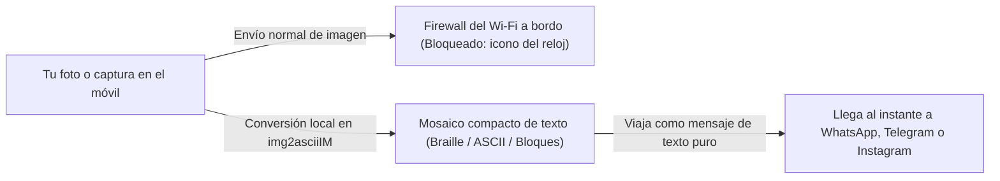
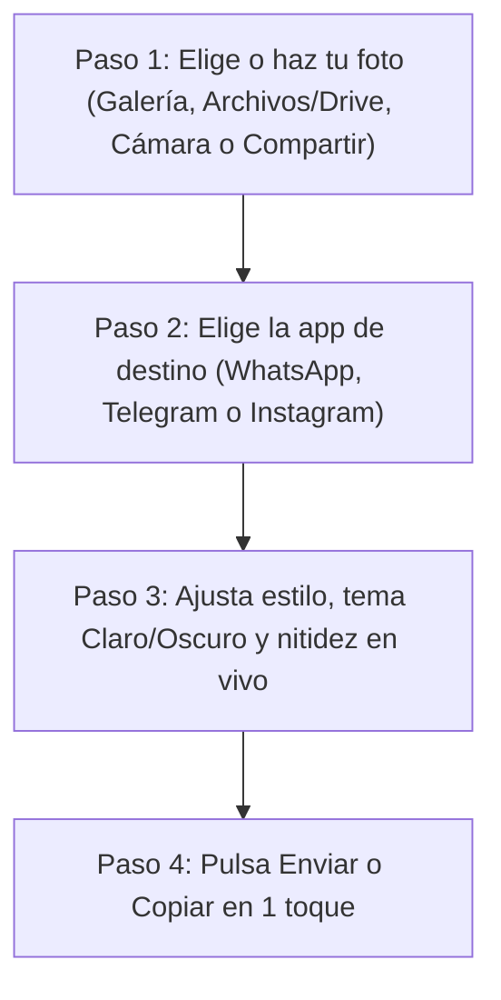

# Guía de Usuario de `img2asciiIM`


> **Comparte cualquier foto, captura o mapa como un mensaje de texto nítido por WhatsApp, Telegram o Instagram Direct cuando tu conexión bloquea las imágenes —100 % sin internet desde tu propio móvil.**

---

## Índice Rápido

1. [¿Qué es `img2asciiIM` y cuándo te salva el viaje?](#1-qué-es-img2asciiim-y-cuándo-te-salva-el-viaje)
2. [Consejo de Oro antes de Despegar (Archivos en la Nube y Google Drive)](#2-consejo-de-oro-antes-de-despegar-archivos-en-la-nube-y-google-drive)
3. [Paso 1: Cómo Elegir o Capturar tu Imagen (4 Formas)](#3-paso-1-cómo-elegir-o-capturar-tu-imagen-4-formas)
4. [Paso 2: Elegir la App de Destino (WhatsApp, Telegram o Instagram)](#4-paso-2-elegir-la-app-de-destino-whatsapp-telegram-o-instagram)
5. [Paso 3: Ajustar el Estilo y la Nitidez (Recetas Rápidas)](#5-paso-3-ajustar-el-estilo-y-la-nitidez-recetas-rápidas)
6. [Paso 4: Enviar en 1 Toque o Copiar al Portapapeles](#6-paso-4-enviar-en-1-toque-o-copiar-al-portapapeles)
7. [Preguntas Frecuentes (FAQ) y Solución de Problemas Rápidos](#7-preguntas-frecuentes-faq-y-solución-de-problemas-rápidos)

---

## 1. ¿Qué es `img2asciiIM` y cuándo te salva el viaje?

¿Alguna vez te has conectado al **Wi-Fi gratuito de mensajería de un avión** (*Free Messaging*), al bono básico de un **crucero** o a una red móvil saturada en una **zona rural, estadio o montaña** y has intentado mandar una foto?

Seguramente viste cómo tus mensajes escritos llegaban al segundo con doble *check*, mientras que cualquier fotografía, captura de pantalla, audio o *sticker* se quedaba congelado indefinidamente con el **icono del reloj (*«Enviando…»*)**.

### ¿Por qué el texto llega al instante pero las fotos se quedan bloqueadas?

Las aplicaciones como **WhatsApp**, **Telegram** e **Instagram Direct** utilizan dos caminos distintos por dentro:
- **Un canal ultraligero de señalización** por el que viajan los mensajes de **texto puro** (ocupa apenas unos pocos kilobytes).
- **Servidores multimedia separados** para subir y descargar fotos, vídeos, notas de voz y *stickers*.

En vuelos comerciales (**Iberia**, **Vueling**, **Lufthansa**, **Delta Air Lines**, **United Airlines**, **Air Europa**, entre otras) y barcos de crucero, el router satelital autoriza el canal ligero de texto para que puedas chatear gratis, pero **bloquea los servidores multimedia y el resto de páginas web** para evitar que el enlace del avión se colapse:



**`img2asciiIM` resuelve este problema en segundos:** convierte cualquier fotografía, mapa del punto de encuentro, cartel de puerta de embarque, plaza de aparcamiento o vista desde la ventanilla en un **dibujo compacto hecho con caracteres de texto** (puntos Braille de alta precisión, arte ASCII clásico o bloques sombreados). Como para la red es un simple mensaje escrito, **atraviesa el Wi-Fi gratuito del avión al instante** y tu contacto reconoce la imagen directamente dentro de su burbuja de chat.

| Situación real | ¿Qué permite la red? | Cómo te ayuda `img2asciiIM` |
| :--- | :--- | :--- |
| **Wi-Fi gratuito en vuelos** (*Free Messaging* en Iberia, Vueling, Lufthansa, Delta, United, Air Europa…) | Solo mensajes de texto en apps de chat; fotos, audios y webs bloqueados. | Convierte tu foto sin internet y la envía como texto plano que llega en el acto. |
| **Cruceros y ferris** (bono básico de chat marítimo) | Texto básico por satélite; subida multimedia desactivada o carísima. | Comparte un selfie, horario de excursión o plano del barco sin pagar el pase multimedia completo. |
| **Montaña, festivales o cobertura rural mínima (`E` / `2G` / `3G` saturado)** | Los megabytes de una foto caducan por falta de señal, pero un texto corto sí sale. | Un mensaje de `img2asciiIM` ocupa **menos de 2 a 4 KB** (miles de veces menos que una foto de cámara). |

### Privacidad total: 100 % en tu móvil y cero permisos invasivos

> [!IMPORTANT]
> **Tus fotos jamás salen de tu teléfono para convertirse.**
> - **Sin conexión a internet (`100 % Offline`):** `img2asciiIM` ni siquiera solicita permiso de acceso a Internet en Android. Toda la conversión ocurre en milisegundos dentro del procesador de tu móvil, incluso con el **Modo Avión** activado.
> - **Sin acceso global a tu galería:** La aplicación nunca pide permiso para leer todas tus fotos o archivos privados. Utiliza los selectores seguros del sistema Android, por lo que únicamente recibe la imagen puntual que tú elijas en cada momento.

---

## 2. Consejo de Oro antes de Despegar (Archivos en la Nube y Google Drive)

`img2asciiIM` se lleva de maravilla con **Google Drive**, Microsoft OneDrive, Dropbox y las fototecas en la nube, pero hay un detalle fundamental que conviene conocer **antes de subir al avión**:

Cuando abres Google Drive o tu galería en la nube sin conexión, muchas veces **ves la miniatura pequeña** de tus archivos porque el móvil guarda esa vista previa, pero **el archivo real en alta calidad sigue guardado únicamente en internet**. Si ya estás a `10.000` metros de altura con el Wi-Fi gratuito del avión, el router bloqueará la descarga desde Google Drive y el archivo no podrá abrirse.

### Qué hacer en el aeropuerto antes de embarcar (30 segundos)

Si llevas en **Google Drive** (o en OneDrive / Dropbox) un plano del hotel, una captura de reserva, un mapa o cualquier imagen que quieras poder enviar durante el vuelo:

1. Abre la app **Google Drive** mientras aún tengas datos móviles o Wi-Fi en tierra.
2. Busca la imagen que te interese y pulsa el icono de tres puntos **`⋮`** a su derecha.
3. Activa la opción **«Disponible sin conexión»** (*Available offline*) —o pulsa **Descargar** para guardarla en tu carpeta local `Descargas`—.

| Origen de la imagen | En tierra (con datos o Wi-Fi normal) | En pleno vuelo (Modo Avión o Wi-Fi *Free Messaging*) |
| :--- | :---: | :--- |
| **Cámara del móvil** | Funciona siempre | **Funciona siempre al 100 %** |
| **Galería local y carpeta `Descargas`** | Funciona siempre | **Funciona siempre al 100 %** |
| **Tarjeta SD o pendrive USB-C** | Funciona siempre | **Funciona siempre al 100 %** |
| **Google Drive / OneDrive / Dropbox** *(marcado «Disponible sin conexión»)* | Funciona siempre | **Funciona siempre** *(se lee de la memoria local)* |
| **Google Drive / Fotos solo en la nube** *(sin descargar antes)* | Funciona (se descarga al momento) | **No disponible** *(el Wi-Fi del avión bloquea la nube)* |

> [!TIP]
> **¿Prefieres preparar tus mensajes con total calma?** Puedes hacer una foto por la ventanilla en **Modo Avión estricto**, ajustar el resultado en `img2asciiIM`, pulsar **Copiar** y conectarte al Wi-Fi del avión solo el instante necesario para pegar y enviar el texto.

---

## 3. Paso 1: Cómo Elegir o Capturar tu Imagen (4 Formas)

El flujo completo en `img2asciiIM` está pensado para que pases de una foto a un mensaje listo en pocos segundos:



Tienes **cuatro maneras** igual de cómodas de cargar una imagen (y si abres cualquiera de ellas por error y pulsas *Atrás*, la imagen y los ajustes que ya tuvieras en pantalla se conservan intactos):

### 1. Botón «Galería»
Abre el selector moderno de fotos de Android para elegir cualquier imagen (`JPEG`, `PNG`, `WebP` o `HEIC`) de tu teléfono o de tu fototeca integrada. No importa si tu cámara hace fotos gigantescas de **48 MP o 108 MP** ni si hiciste la foto con el móvil girado: `img2asciiIM` reduce el tamaño de forma inteligente sin agotar la batería ni la memoria y **endereza automáticamente la orientación**.

### 2. Botón «Archivos / Drive»
Abre el explorador universal de documentos de Android. Es la opción ideal cuando la imagen no está en tu carrete de fotos habitual, sino en:
- Tu unidad de **Google Drive**, OneDrive, Dropbox o Nextcloud.
- La carpeta **`Descargas`** (por ejemplo, un plano descargado del correo o de la web de la aerolínea).
- Una **tarjeta microSD** o un **pendrive / lector de tarjetas USB-C** conectado al teléfono.

### 3. Botón «Cámara»
Dispara una foto al momento sin salir de `img2asciiIM`. Es perfecta durante el viaje para capturar:
- Las vistas de las alas, las nubes o el amanecer desde la **ventanilla del avión**.
- El panel luminoso con tu **puerta de embarque**, cinta de equipaje o vía de tren.
- El número de columna y planta donde dejaste el coche en el **parking del aeropuerto**.
- Un **mapa impreso** o cartel informativo.

*(Las capturas temporales de cámara se guardan únicamente en la caché privada de la app y se limpian automáticamente para no llenar el espacio de tu teléfono).*

### 4. Desde otra app con el menú «Compartir» (la vía más rápida)
Si ya tienes una imagen abierta en tu app de **Galería**, en **Google Drive** o en tu gestor de archivos:
1. Toca el botón estándar **Compartir** de Android.
2. Elige **`img2asciiIM`** en la lista de aplicaciones.
3. La aplicación se abrirá directamente con esa foto **ya convertida** en la vista previa, ahorrándote buscarla de nuevo.

---

## 4. Paso 2: Elegir la App de Destino (WhatsApp, Telegram o Instagram)

Cada aplicación de mensajería tiene sus propias reglas sobre **el tipo de letra** y **el tamaño máximo permitido por mensaje**. Si envías el mismo bloque de texto sin adaptarlo, en unas apps se verá torcido y en otras se cortará por la mitad.

Al tocar arriba **WhatsApp**, **Telegram** o **Instagram Direct**, `img2asciiIM` configura automáticamente todas las medidas internas por ti:

| App de Destino | Qué hace `img2asciiIM` automáticamente | Modo Inicial | Límite Seguro |
| :--- | :--- | :--- | :--- |
| **WhatsApp** *(y WhatsApp Business)* | Envuelve el dibujo en triple tilde ```` ```...``` ```` para activar la **letra monoespaciada** (ancho fijo), elimina símbolos que romperían el formato y ajusta el ancho a **`~32` columnas** para pantallas verticales. | **ASCII** *(admite Braille y Bloques)* | Hasta `65.536` caracteres *(ajuste ágil `≤ 4.000`)* |
| **Telegram** | Ajusta automáticamente el tamaño para no superar jamás los **`4.096` caracteres** (evitando que Telegram parta tu imagen en dos mensajes distintos) y usa **Braille directo** (`~30` columnas) limpio y de alta resolución. | **Braille** *(admite ASCII y Bloques)* | **`4.096` caracteres** exactos |
| **Instagram Direct** | Desactiva los símbolos ```` ``` ```` (Instagram no los soporta), activa **Braille Unicode** con espacios especiales indestructibles (`⠀`) que mantienen la forma perfecta en la fuente normal de Instagram, y compacta el tamaño (`~22–24` columnas) por debajo de **`1.000` caracteres**. | **Braille** *(o Bloques)* | **`1.000` caracteres** estrictos |

### Detalles clave de cada plataforma

- **En WhatsApp:** WhatsApp exige el bloque ```` ``` ```` para alinear las columnas, pero tiene una trampa oculta: si el dibujo contiene una tilde invertida `` ` `` o empieza con espacios normales en blanco, WhatsApp desactiva el formato monoespaciado y desarma toda la imagen. `img2asciiIM` filtra y sustituye automáticamente esos caracteres para que el bloque **nunca se rompa**.
- **En Telegram:** Si intentas mandar una captura de pantalla muy alargada que supere `4.096` caracteres, Telegram normalmente corta el texto en dos burbujas separadas. `img2asciiIM` **recalcula las proporciones de forma automática** para que tu imagen entre siempre entera en **un único mensaje**. Además, si cambias manualmente a modo ASCII clásico, añade un salto de línea protector tras ```` ``` ```` para que Telegram no borre la primera fila confundiéndola con el nombre de un lenguaje de programación.
- **En Instagram Direct:** Instagram Direct no tiene letra monoespaciada (una `W` es mucho más ancha que un punto `.`) y además encoge los espacios normales. Por eso `img2asciiIM` utiliza el modo especial **Braille Unicode (`⠀..⣿`)**: Android dibuja todas las celdas Braille con el mismo ancho —incluida la celda vacía especial `⠀`— logrando que la imagen mantenga su geometría exacta dentro del estricto tope de `1.000` caracteres.

> [!WARNING]
> **Evita usar «ASCII clásico» en Instagram Direct.** Si seleccionas manualmente el modo ASCII teniendo elegido el perfil de Instagram, la app te mostrará un aviso porque la letra proporcional de Instagram desalineará las columnas. Para Instagram Direct, usa siempre **Braille** (máximo detalle) o **Bloques** (iconos sencillos de alto contraste).

---

## 5. Paso 3: Ajustar el Estilo y la Nitidez (Recetas Rápidas)

Justo encima de los controles verás la **Vista Previa de Burbuja**, que te muestra en tiempo real cómo quedará el mensaje junto con el contador de **`caracteres actuales / límite máximo`** y el tamaño en **`columnas × filas`**.

### A. Elige entre los 3 Estilos de Dibujo

- **Braille (`⠀..⣿`) — Máxima definición fotográfica:**
  Cada carácter es una rejilla de **8 micropuntos (`2 × 4`)**, lo que multiplica por ocho los detalles que caben en cada letra. Es la mejor opción para **rostros, selfies, paisajes desde la ventanilla, planos con calles y capturas detalladas**, y funciona de maravilla en las tres aplicaciones.
- **ASCII (`@#%...`) — El estilo retro clásico:**
  Construye la imagen combinando letras y signos clásicos (`@%#*+=-:.`). Es ideal en **WhatsApp** (o al copiar y pegar código en **Telegram**) cuando quieres ese aspecto informático auténtico de máquina de escribir.
- **Bloques (`█▓▒░`) — Trazos sólidos y alto impacto:**
  Rellena las zonas con bloques de distinta intensidad. Funciona genial para **logotipos, iconos grandes, señales de dirección, dibujos sencillos o siluetas muy contrastadas**.

### B. El truco maestro: Tema Claro vs. Tema Oscuro (Botón «Invertir»)

A diferencia de una foto normal, un mensaje de texto se pinta con el color de letra del teléfono de quien lo lee:
- En un móvil en **Modo Claro**, la burbuja de chat es clara (blanca o verde pálido) y las letras son **oscuras** (cuantos más puntos pones, más **oscura** se ve esa zona).
- En un móvil en **Modo Oscuro**, la burbuja es casi negra y las letras son **blancas** (cuantos más puntos pones, más **brillante** se ve esa zona).

Por eso, si envías un retrato pensado para fondo claro a alguien que usa Modo Oscuro, lo verá como el negativo de una foto antigua (pelo blanco y cara oscura).

1. Usa el **conmutador de vista previa (Burbuja Clara / Burbuja Oscura)** para simular la pantalla de tu amigo.
2. Activa o desactiva el botón **Invertir** según cómo use el móvil tu destinatario:
   - **Tu contacto usa Modo Claro:** deja **Invertir desactivado**.
   - **Tu contacto usa Modo Oscuro:** activa **Invertir**.

*(Si abres un logotipo o sticker `PNG` / `WebP` con fondo transparente, `img2asciiIM` adapta automáticamente el fondo transparente al modo elegido para que no aparezca un recuadro negro indeseado).*

### C. Brillo, Contraste, Ancho y Dithering (Tramado)

- **Ancho (columnas):** Controla cuántas letras ocupa cada fila a lo ancho (`12` a `72` columnas). El valor inicial ya viene calibrado para cada app (`32` en WhatsApp, `30` en Telegram, `22–24` en Instagram). Si tu contacto tiene un móvil pequeño o usa un tamaño de letra grande en Android, bájalo un poco para evitar que las líneas salten de renglón.
- **Brillo y Contraste:** Las fotos tomadas a través del cristal doble de la ventanilla del avión suelen salir algo blanquecinas o con neblina. Subir ligeramente el **Contraste** hace que las nubes, el ala o el horizonte destaquen al instante.
- **Dithering (Tramado de sombras):** Decide cómo se traducen los tonos grises suaves a puntos:
  - **Floyd-Steinberg:** Reparte los matices de forma suave y orgánica. Es el mejor para **caras, retratos, cielos y fotografías naturales**.
  - **Atkinson:** Marca mucho más los bordes y deja los fondos limpios sin ruido. Es espectacular para **mapas, carteles de aeropuerto, horarios, siluetas y retratos pequeños**.
  - **Sin tramado (`Ninguno`):** Aplica un corte directo blanco/negro. Úsalo para **logotipos limpios, dibujos en blanco y negro o iconos planos**.

### Tabla de Recetas Rápidas

| Qué quieres enviar | Estilo recomendado | Dithering (Tramado) | Consejo extra |
| :--- | :--- | :--- | :--- |
| **Selfie o foto de personas** | **Braille (`⠀..⣿`)** | **Floyd-Steinberg** | Acerca o encuadra bien las caras y ajusta **Invertir** según el tema (claro/oscuro) de tu contacto. |
| **Vistas desde la ventanilla (alas, nubes, puesta de sol)** | **Braille (`⠀..⣿`)** | **Floyd-Steinberg** | Sube un poco el **Contraste** para compensar el reflejo del cristal del avión. |
| **Mapa de punto de encuentro, cartel o puerta de embarque** | **Braille (`⠀..⣿`)** | **Atkinson** | El tramado *Atkinson* perfila letras grandes, flechas y calles con mucha mayor claridad. |
| **Estilo retro en un grupo de WhatsApp** | **ASCII (`@#%...`)** | **Floyd-Steinberg** o **Atkinson** | Mantén el ancho entre `28` y `32` columnas para que todos en el grupo lo vean sin cortes. |
| **Logo, bandera, señal o silueta fuerte** | **Bloques (`█▓▒░`)** | **Sin tramado** *(o Atkinson)* | Contraste alto para conseguir bloques limpios y reconocibles al primer golpe de vista. |

---

## 6. Paso 4: Enviar en 1 Toque o Copiar al Portapapeles

Cuando la vista previa de burbuja se vea a tu gusto, tienes dos acciones directas en la parte inferior:

### Opción A: Botón «Enviar a WhatsApp / Telegram / Instagram»
- Lanza directamente la aplicación de mensajería seleccionada con tu mensaje preparado para que solo tengas que **tocar el chat de tu contacto y pulsar Enviar**.
- Si utilizas una variante oficial (como **WhatsApp Business**) o en ese teléfono no tienes instalada esa aplicación concreta, `img2asciiIM` abrirá automáticamente el menú estándar **Compartir** de Android para que puedas enviarlo por cualquier otra vía sin errores.

> [!NOTE]
> **¿Cómo funciona el envío rápido a Instagram Direct (*Copiado Automático*)?**
> Por limitaciones propias de la app de Instagram en Android, algunas versiones de Instagram abren la lista de chats pero ignoran los textos externos cuando no contienen un enlace web.
> Para que nunca pierdas un segundo, al pulsar **«Enviar a Instagram»**, `img2asciiIM` **guarda siempre primero tu arte en el portapapeles de forma automática** antes de abrir Instagram:
> 1. Si Instagram rellena el mensaje solo, simplemente elige a tu contacto y envíalo.
> 2. Si Instagram abre tus mensajes directos en blanco, entra en el chat de la persona, **mantén pulsado el cuadro *«Enviar mensaje…»*** y toca **Pegar**. ¡Tu imagen en Braille aparecerá entera y lista para enviar!

### Opción B: Botón «Copiar»
- Copia el resultado exacto al portapapeles de Android en **1 solo toque** (notarás una suave vibración de confirmación y el aviso del sistema).
- Es comodísimo cuando:
  - Ya tienes la conversación abierta en segundo plano y prefieres cambiar de app y pegar manualmente.
  - Quieres pegar el dibujo en **otra app compatible con el Wi-Fi del avión** (como Facebook Messenger, Google Messages, Signal, Slack o notas personales).
  - En **Telegram** has elegido expresamente el modo **ASCII clásico** con bloque ```` ``` ```` y quieres pegarlo directamente en la caja de escritura del chat para que Telegram aplique el formato de código al instante.

---

## 7. Preguntas Frecuentes (FAQ) y Solución de Problemas Rápidos

### «Mi amigo me dice que ve las líneas partidas en dos renglones o la imagen "descuadrada"»
**Causa:** Cada fila de tu dibujo es un poquito más ancha que la burbuja de chat del móvil de tu amigo (ocurre cuando su teléfono tiene la pantalla estrecha o lleva activada la opción de **Tamaño de fuente grande** en los ajustes de accesibilidad de Android/iPhone).  
**Solución rápida:** Baja el deslizador de **Ancho** unas `4` o `6` columnas (por ejemplo, ponlo en **`24–26` columnas** para WhatsApp/Telegram o **`18–20` columnas** para Instagram Direct) y vuelve a enviarlo. Se verá perfectamente alineado en cualquier pantalla.

---

### «La imagen se reconoce, pero se ve rara, como en negativo (las caras oscuras y el fondo brillante)»
**Causa:** Estás enviando la imagen con el ajuste pensado para Modo Claro a alguien que tiene el móvil en **Modo Oscuro** (o viceversa).  
**Solución rápida:** Toca el botón **Invertir** en el Paso 3 y comprueba el resultado cambiando el interruptor **Claro / Oscuro** de la vista previa antes de reenviarlo.

---

### «Intento abrir un archivo de Google Drive en mitad del vuelo y dice que no está disponible sin conexión»
**Causa:** Aunque Google Drive te muestre la miniatura del archivo en la lista, la imagen completa nunca llegó a descargarse en la memoria interna de tu móvil antes del despegue, y el Wi-Fi gratuito del avión bloquea la conexión con los servidores de Google Drive.  
**Solución:**
- **Para el próximo vuelo:** Marca tus documentos importantes con **«Disponible sin conexión»** dentro de Google Drive antes de embarcar (ver [Consejo de Oro antes de Despegar](#2-consejo-de-oro-antes-de-despegar-archivos-en-la-nube-y-google-drive)).
- **Si ya estás volando:** Comprueba si habías descargado antes esa imagen en tu carpeta local **`Descargas`** o en tu **Galería**, o haz una foto directa con el botón **Cámara** si tienes el documento en papel o en la pantalla de otro dispositivo (como tu portátil o tablet).

---

### «En WhatsApp el mensaje sale con un botón "Leer más" abajo»
**Causa:** WhatsApp pliega visualmente cualquier mensaje de más de unas `15–20` líneas para no ocupar toda la pantalla del chat de golpe.  
**Solución:** No está cortado: en cuanto tu contacto toca **«Leer más»**, la burbuja se despliega entera manteniendo la alineación perfecta. Si prefieres que tu imagen se vea completa desde el primer vistazo sin tener que pulsar *«Leer más»*, reduce ligeramente el **Ancho** (al bajar el ancho también disminuye el número de filas de alto manteniendo la proporción).

---

### «¿Puedo enviar el código QR de mi tarjeta de embarque con `img2asciiIM` para pasar por el torno del aeropuerto?»
**No para lectores láser u ópticos.** `img2asciiIM` está diseñado para que **una persona vea y entienda visualmente** una foto, el número de puerta, el asiento asignado, un mapa o una cara cuando no puedes mandar imágenes. Los escáneres ópticos de seguridad y embarque del aeropuerto necesitan el código QR original de alta precisión, no una recreación artística en caracteres de texto.

---

### «¿Consume batería o datos móviles convertir varias fotos seguidas?»
**Consumo mínimo y cero datos.** La conversión tarda menos de una décima de segundo en tu procesador, no utiliza internet en ningún momento y procesa las fotos de forma optimizada en memoria para cuidar tanto tu privacidad como la batería durante todo el vuelo.
