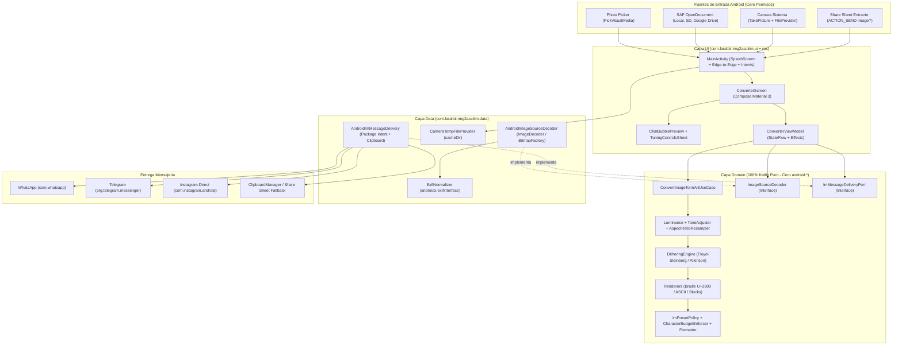
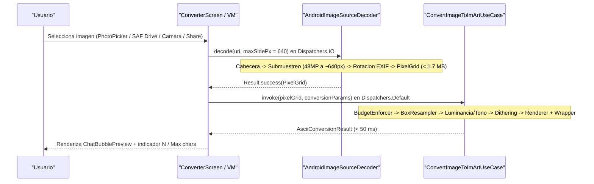
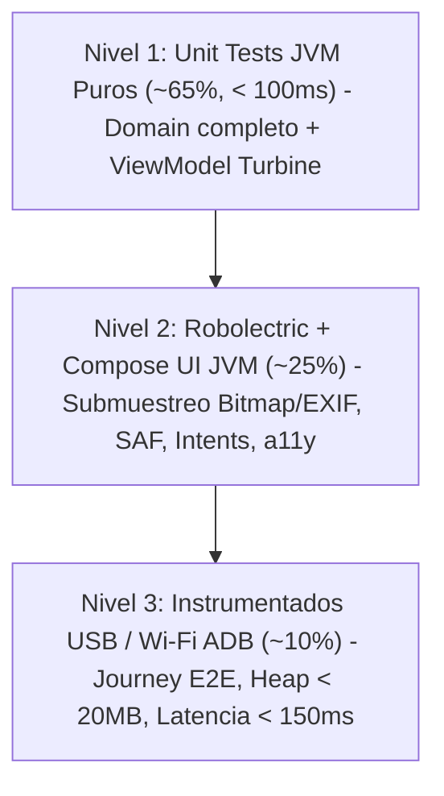

# Plan Arquitectónico `001`: `img2asciiIM` (Clean Architecture + TDD)

| Campo | Valor |
| :--- | :--- |
| **Especificación Asociada** | [`specs/001-core-img2ascii-im/spec.md`](spec.md) |
| **Hoja de Ruta TDD** | [`specs/001-core-img2ascii-im/tasks.md`](tasks.md) |
| **Namespace / Paquete Raíz** | `com.laralbir.img2asciiim` |
| **Arquitectura** | Clean Architecture (`domain` ← `data`, `domain` ← `ui`) + UDF (`StateFlow`) |

---

## 1. Diagrama de Flujo de Dependencias y Capas

La regla de dependencia apunta estrictamente hacia `domain`. El núcleo matemático desconoce por completo Android SDK, Jetpack Compose, `Bitmap` o `Uri`.



---

## 2. Estructura de Paquetes, Recursos de Identidad Visual y Activos

### 2.1 Código Fuente Kotlin (`app/src/main/java/com/laralbir/img2asciiim/`)

```text
com.laralbir.img2asciiim/
├── domain/                          # 100% Kotlin puro (JVM < 100 ms, cero imports android.*)
│   ├── model/
│   │   ├── ImageSourceRef.kt        # Value class / wrapper opaco de identificador de imagen
│   │   ├── PixelGrid.kt             # Rejilla ARGB/Luminancia pre-escalada e inmutable
│   │   ├── CharsetMode.kt           # BRAILLE_UNICODE, ASCII_CLASSIC, UNICODE_BLOCKS
│   │   ├── DitherMode.kt            # NONE, FLOYD_STEINBERG, ATKINSON
│   │   ├── ImPlatformPreset.kt      # WHATSAPP, TELEGRAM, INSTAGRAM_DM (reglas y límites)
│   │   ├── ConversionParams.kt      # widthColumns, brightness, contrast, invert, dither, mode, preset
│   │   ├── AsciiConversionResult.kt # rawArt, formattedMessage, cols, rows, charCount, maxChars, wasAutoScaled
│   │   └── DomainError.kt           # InvalidOrCorruptedImage, CloudFileOfflineUnavailable, EmptyImage
│   ├── engine/
│   │   ├── LuminanceExtractor.kt    # Composición Alfa + luminancia perceptual BT.709
│   │   ├── ToneAdjuster.kt          # Brillo [-1..1], contraste [0.5..3.0] e inversión claro/oscuro
│   │   ├── AspectRatioResampler.kt  # Box/Area-averaging resampler con compensación tipográfica
│   │   ├── DitheringEngine.kt       # Difusión de error sobre buffer FloatArray reutilizable
│   │   ├── BrailleUnicodeRenderer.kt# Subceldas 2x4 -> U+2800..U+28FF (U+2800 para vacío)
│   │   ├── AsciiClassicRenderer.kt  # Rampa monoespaciada "@%#*+=-:. "
│   │   └── UnicodeBlockRenderer.kt  # Rampa de bloques "█▓▒░ " / "█▓▒░⠀"
│   ├── preset/
│   │   ├── CharacterBudgetEnforcer.kt # Calcula el ancho máximo exacto <= 1.000 / 4.096 / 65.536
│   │   └── ImMessageFormatter.kt    # Envoltorio ```\n...\n``` vs texto directo sin backticks
│   ├── port/
│   │   └── ImageSourceDecoder.kt    # suspend fun decode(source: ImageSourceRef, maxSidePx: Int): Result<PixelGrid>
│   └── usecase/
│       └── ConvertImageToImArtUseCase.kt
│
├── data/                            # Adaptadores Android SDK (ContentResolver, Bitmap, EXIF, Intents)
│   ├── image/
│   │   ├── AndroidImageSourceDecoder.kt # Submuestreo previo + lectura segura de streams SAF/Drive
│   │   ├── SampleSizeCalculator.kt  # Cálculo determinista de inSampleSize / targetSize
│   │   ├── ExifOrientationNormalizer.kt # Transformación matricial de las 8 orientaciones EXIF
│   │   └── CameraCaptureFileStore.kt# Creación y purga de temporales en cacheDir/camera_captures/
│   └── share/
│       ├── ImShareIntentFactory.kt  # ACTION_SEND dirigido + detección de paquete + chooser fallback
│       └── SystemClipboardAdapter.kt# Copia en ClipData("img2asciiIM", formattedMessage)
│
├── ui/                              # Jetpack Compose Material 3 + Edge-to-Edge + Navigation 3
│   ├── navigation/
│   │   └── AppNavigation.kt         # Grafo Navigation 3 preparado para ampliación modular
│   ├── converter/
│   │   ├── ConverterUiState.kt      # Estado inmutable único expuesto por StateFlow
│   │   ├── ConverterUiEvent.kt      # Acciones del usuario (sealed interface)
│   │   ├── ConverterUiEffect.kt     # Efectos efímeros (copiado, lanzar intent, snackbar)
│   │   ├── ConverterViewModel.kt    # Orquestación reactiva (collectLatest en Dispatchers.Default)
│   │   ├── ConverterScreen.kt       # Pantalla principal adaptativa
│   │   └── components/
│   │       ├── SourceIngestionBar.kt    # Botones Galería, Archivos/Drive (SAF), Cámara
│   │       ├── ImPresetSelectorRow.kt   # Chips WhatsApp, Telegram, Instagram Direct
│   │       ├── ChatBubblePreviewCard.kt # Burbuja realista + toggle claro/oscuro + contador N/Max
│   │       ├── TuningControlsPanel.kt   # Sliders ancho, brillo, contraste, dithering, invertir
│   │       └── DeliveryBottomBar.kt     # Copiar en 1 toque + Enviar directo a la app IM
│   └── theme/
│       └── Theme.kt                 # Tema Material 3 dinámico + tipografías Monospace / Sans
│
└── di/
    └── AppContainer.kt              # Inyección de dependencias ligera en Kotlin puro (cero reflexión)
```

### 2.2 Jerarquía de Recursos Android y Activos de Launch (`RF-05`)

```text
app/src/main/res/
├── drawable/
│   ├── ic_launcher_background.xml   # 108dp × 108dp: fondo oscuro corporativo (#0D1117) + rejilla sutil
│   ├── ic_launcher_foreground.xml   # 108dp × 108dp: glifo inscrito en zona segura central de 66dp × 66dp (margen 21dp)
│   ├── ic_launcher_monochrome.xml   # 108dp × 108dp: silueta monocroma 1 canal para Themed Icons (Android 13+ / API 33+)
│   ├── ic_splash_logo.xml           # 240dp × 240dp (zona segura 160dp): AnimatedVectorDrawable <= 300 ms (DD-05 Opción A)
│   └── ic_splash_branding.xml       # 200dp × 80dp: marca tipográfica monoespaciada limpia "img2asciiIM"
├── mipmap-anydpi-v26/
│   ├── ic_launcher.xml              # <adaptive-icon>: <background>, <foreground> y <monochrome>
│   └── ic_launcher_round.xml        # <adaptive-icon>: <background>, <foreground> y <monochrome>
├── mipmap-mdpi/                     # ic_launcher.webp + ic_launcher_round.webp (48 × 48 px)
├── mipmap-hdpi/                     # ic_launcher.webp + ic_launcher_round.webp (72 × 72 px)
├── mipmap-xhdpi/                    # ic_launcher.webp + ic_launcher_round.webp (96 × 96 px)
├── mipmap-xxhdpi/                   # ic_launcher.webp + ic_launcher_round.webp (144 × 144 px)
├── mipmap-xxxhdpi/                  # ic_launcher.webp + ic_launcher_round.webp (192 × 192 px)
├── values/
│   └── themes.xml                   # Theme.Img2asciiIM.Starting (Theme.SplashScreen) -> Theme.Img2asciiIM (Claro)
├── values-night/
│   └── themes.xml                   # Theme.Img2asciiIM.Starting (fondo oscuro #0D1117 sin destellos blancos)
└── values-v31/
    └── themes.xml                   # Extiende Theme.Img2asciiIM.Starting con android:windowSplashScreenBrandingImage

docs/assets/
├── banner.png                       # Banner principal existente del repositorio (referencia cromática y estilística)
├── icon-512.png                     # Icono maestro de alta resolución (512 × 512 px PNG) para tienda y releases
└── launch-feature-1024x500.png      # Feature Graphic / imagen promocional de lanzamiento (1024 × 500 px PNG)
```

---

## 3. Pipeline de Procesamiento y Presupuesto de Memoria / Tiempo



### Decisiones Técnicas Clave del Pipeline

1. **Tope de Memoria `< 20 MB` garantizado por diseño (`RNF-02`):**
   - El ancho máximo permitido en mensajería es `72` columnas; incluso en modo `BRAILLE_UNICODE` (`2×4` subpíxeles), la rejilla efectiva máxima requiere apenas `144` subpíxeles horizontales.
   - Decodificar la imagen de origen a un lado máximo de **`640 px`** ofrece más de `4×` de sobremuestreo para el *box-averaging resampler* mientras que un `Bitmap` ARGB_8888 de `640 × 640` ocupa solo **`1,64 MB`** (frente a los **`192 MB`** que consumiría decodificar en crudo una foto de `48 MP` `8000 × 6000`).
   - Una vez copiado a `PixelGrid`, el `Bitmap` temporal queda elegible de inmediato para GC sin almacenarse nunca en `ConverterUiState`.

2. **Matemática del Presupuesto de Caracteres (`CharacterBudgetEnforcer`):**
   - Para un número de columnas `C` y filas `R`, el arte crudo ocupa `L_raw(C, R) = R * C + (R - 1)` caracteres (cada fila tiene `C` caracteres y hay `R - 1` saltos `\n`).
   - Si el perfil lleva envoltorio monoespaciado (```` ```\n ```` + ```` \n``` ````), el coste fijo adicional es `W = 8` caracteres (`W = 0` en Instagram Direct).
   - Longitud total exacta: `L_total(C, R) = R * (C + 1) - 1 + W`.
   - Dado que `R = max(1, round(C * (imgHeight / imgWidth) * verticalScaleFactor))` es monótona creciente respecto a `C`, si `L_total(C_solicitado) > MaxBudget` (`1.000` en Instagram DM o `4.096` en Telegram), `CharacterBudgetEnforcer` halla mediante **búsqueda binaria en `O(log C)`** el mayor `C_efectivo` tal que `L_total(C_efectivo) <= MaxBudget`.

3. **Integración Limpia con el Manifiesto Android (`AndroidManifest.xml`):**
   - **Permisos:** Cero `INTERNET`, cero `READ_MEDIA_IMAGES`, cero `READ_EXTERNAL_STORAGE`, cero `CAMERA` (`DD-01 Opción A`).
   - **Identidad Visual y Tema de Arranque (`RF-05`):** `<application android:icon="@mipmap/ic_launcher" android:roundIcon="@mipmap/ic_launcher_round" android:theme="@style/Theme.Img2asciiIM.Starting">`, con `MainActivity` como única actividad de entrada (prohibida cualquier `SplashActivity` intermedia).
   - **Visibilidad de Paquetes Android 11+ (`<queries>`):**
     ```xml
     <queries>
         <package android:name="com.whatsapp" />
         <package android:name="com.whatsapp.w4b" />
         <package android:name="org.telegram.messenger" />
         <package android:name="org.thunderdog.challegram" />
         <package android:name="com.instagram.android" />
     </queries>
     ```
   - **`FileProvider`:** Configurado exclusivamente sobre `<cache-path name="camera_captures" path="camera_captures/" />` con `android:exported="false"` y `android:grantUriPermissions="true"`.
   - **Receptor Share Sheet:** `<intent-filter>` con `android.intent.action.SEND`, categoría `DEFAULT` y `mimeType="image/*"`.

4. **Secuencia de Arranque Nativa (`androidx.core:core-splashscreen`) y Pipeline de Activos (`RF-05`):**
   - **Catálogo de Versiones (`gradle/libs.versions.toml`) y Dependencia:**
     - `coreSplashscreen = "1.2.0"` y entrada `androidx-core-splashscreen = { group = "androidx.core", name = "core-splashscreen", version.ref = "coreSplashscreen" }` consumida en `app/build.gradle.kts` (`implementation(libs.androidx.core.splashscreen)`).
   - **Orden Estricto en `MainActivity.onCreate(savedInstanceState: Bundle?)`:**
     ```kotlin
     override fun onCreate(savedInstanceState: Bundle?) {
         installSplashScreen() // 1. Antes de super.onCreate(): aplica postSplashScreenTheme (Theme.Img2asciiIM)
         super.onCreate(savedInstanceState)
         enableEdgeToEdge()    // 2. Configura barras transparentes inmersivas sobre el tema definitivo
         handleIncomingShareIntent(intent)
         setContent {
             Img2asciiIMTheme {
                 AppNavigation(...)
             }
         }
     }
     ```
     No se registra ningún `setKeepOnScreenCondition` con temporizadores ni `delay()`: la animación vectorial (`AnimatedVectorDrawable` `≤ 300 ms`) acompaña el arranque en frío sin retener el primer fotograma de Compose.
   - **Pipeline de Generación de Activos (`image-generator` + Tooling Vectorial/WebP):**
     1. Generación de los activos maestros de publicación `docs/assets/icon-512.png` (`512 × 512 px`) y `docs/assets/launch-feature-1024x500.png` (`1024 × 500 px`) con `image-generator`, asegurando continuidad visual con `docs/assets/banner.png` (`#0D1117`, acentos esmeralda/cian, motivo avión/imagen → puntos Braille/ASCII en burbuja IM).
     2. Construcción geométrica determinista de los `VectorDrawable` / `AnimatedVectorDrawable` en `res/drawable/` verificando matemáticamente las zonas seguras (`66dp` centrales en `108dp` para launcher; `160dp` centrales en `240dp` para splash).
     3. Rasterización y codificación `.webp` sin pérdida para las 5 densidades `mipmap-{mdpi..xxxhdpi}` (`48`, `72`, `96`, `144`, `192` px), eliminando por completo los binarios por defecto del template.

---

## 4. Estrategia de Pruebas (Pirámide TDD)



### Nivel 1 — Unit Tests JVM Puros (`./gradlew testDebugUnitTest`)
- **Alcance:** Todo `domain/**` y `ConverterViewModel`.
- **Herramientas:** JUnit, `kotlin.test`, `kotlinx-coroutines-test` (`StandardTestDispatcher`, `runTest`), `app.cash.turbine:turbine`.
- **Garantías:** Verifica bit a bit cada punto Braille `U+2800..U+28FF`, conservación de proporciones, difusión de error Floyd-Steinberg/Atkinson, límites exactos de `1.000`, `4.096` y `65.536` caracteres y transiciones del `StateFlow` ante deslizamientos rápidos de controles. Tiempo objetivo de toda la capa `domain/`: **< 100 ms**.

### Nivel 2 — Integración Android & UI en JVM con Robolectric (`./gradlew testDebugUnitTest`)
- **Alcance:** `data/**` (`AndroidImageSourceDecoder`, `ExifOrientationNormalizer`, `ImShareIntentFactory`, auditoría de `AndroidManifest.xml`), `ui/**` (`ConverterScreen` con `createComposeRule()`) y `res/**` + `docs/assets/**` (`BrandAssetsAndSplashRobolectricTest`).
- **Herramientas:** Robolectric, `androidx.compose.ui:ui-test-junit4`, `ExifInterface`, `ActivityScenario`.
- **Garantías:** Confirma que decodificar imágenes grandes aplica `inSampleSize > 1`, que `IOException` de un archivo de Google Drive sin caché no rompe el proceso, que `ACTION_SEND` apunta al paquete correcto o cae en `Intent.createChooser`, que todos los nodos interactivos cumplen accesibilidad, y que el icono adaptativo incluye `<background>`, `<foreground>` y `<monochrome>`, los `.webp` y PNGs maestros (`512×512`, `1024×500`) tienen dimensiones exactas sin hashes del template y `MainActivity` arranca en frío con `Theme.Img2asciiIM.Starting` → `installSplashScreen()` → `Theme.Img2asciiIM`.

### Nivel 3 — Instrumentados End-to-End en Dispositivo Físico / AVD (`./gradlew connectedDebugAndroidTest`)
- **Alcance:** Flujo integrado sobre runtime ART real conectado por **USB o Wi-Fi ADB**, incluyendo arranque en frío (*cold start*) con `SplashScreen` nativa.
- **Herramientas:** AndroidX Test Runner, Compose Android UI Test, `ClipboardManager` real del sistema, perfilado de memoria `Runtime.getRuntime()`.
- **Garantías:** Certifica en silicio real que el arranque en frío transiciona instantáneamente de `SplashScreen` a `ConverterScreen` sin pantallas en blanco ni demoras artificiales, que una imagen generada de `8000 × 6000` (48 MP) se convierte en `< 150 ms` consumiendo `< 20 MB` de RAM adicional, que `U+2800` mantiene alineación visual en el motor tipográfico Skia/Minikin de Android y que todo funciona sin conectividad de red.
